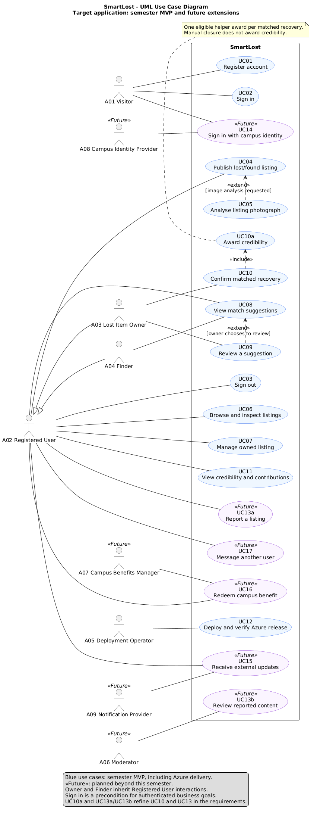
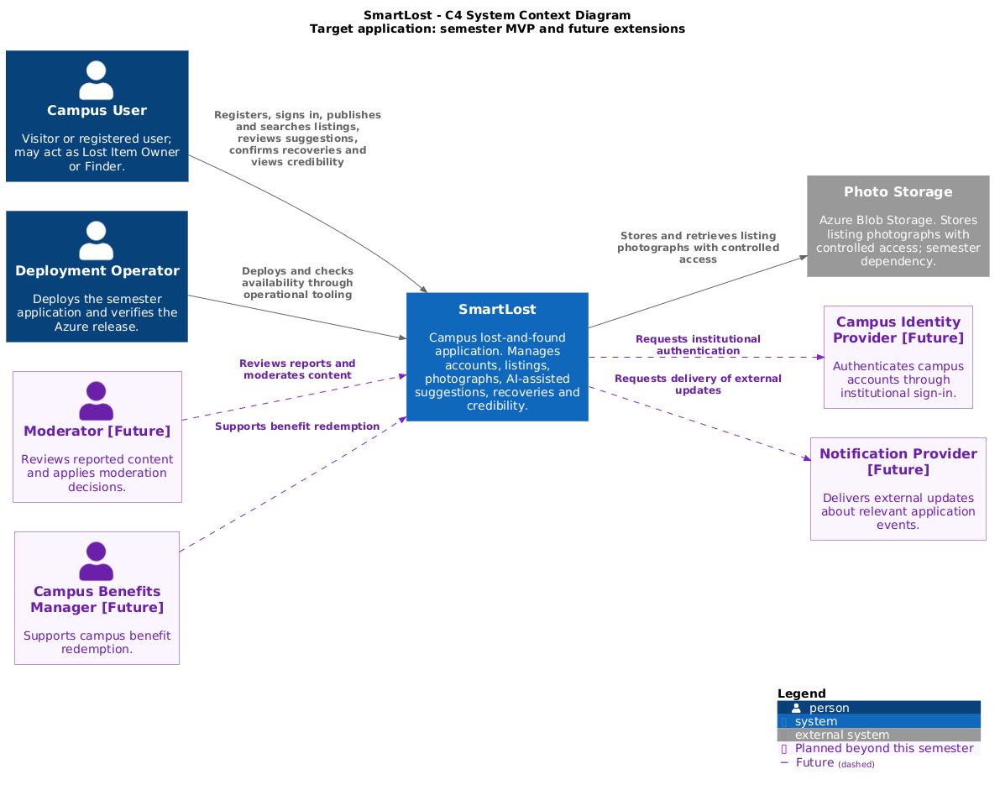
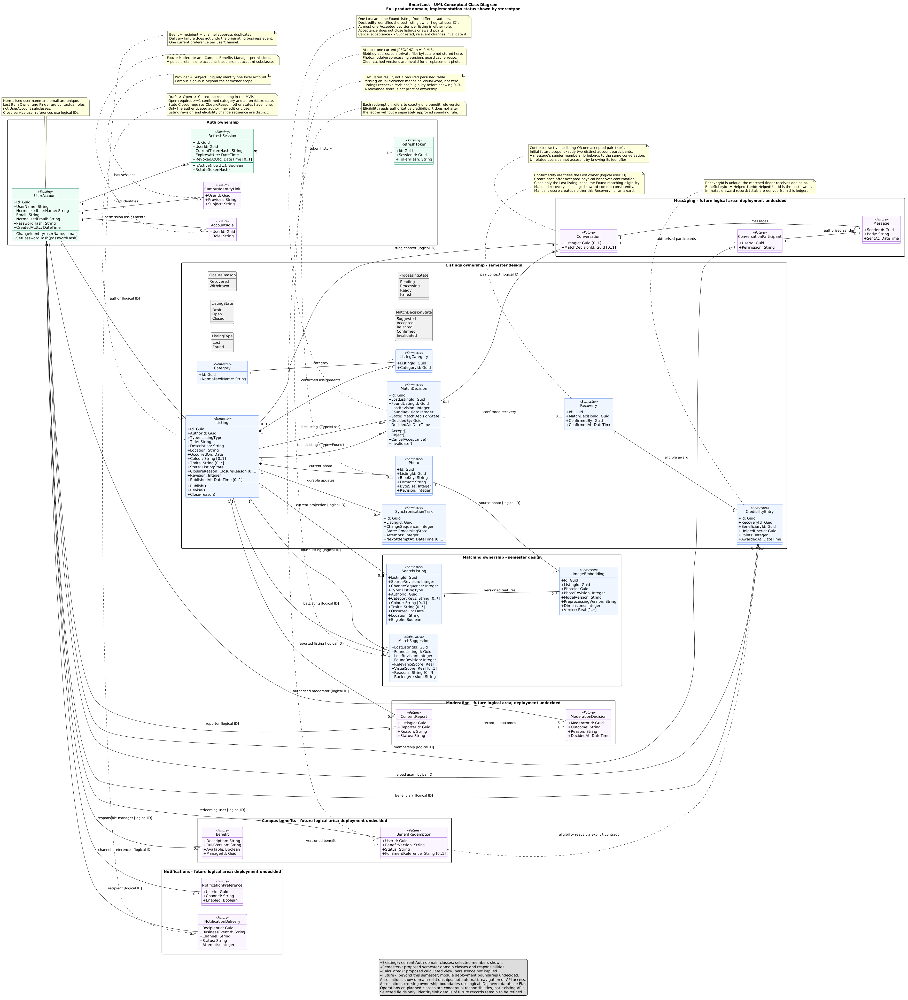
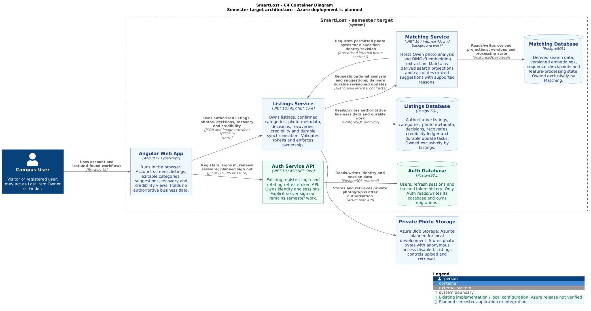
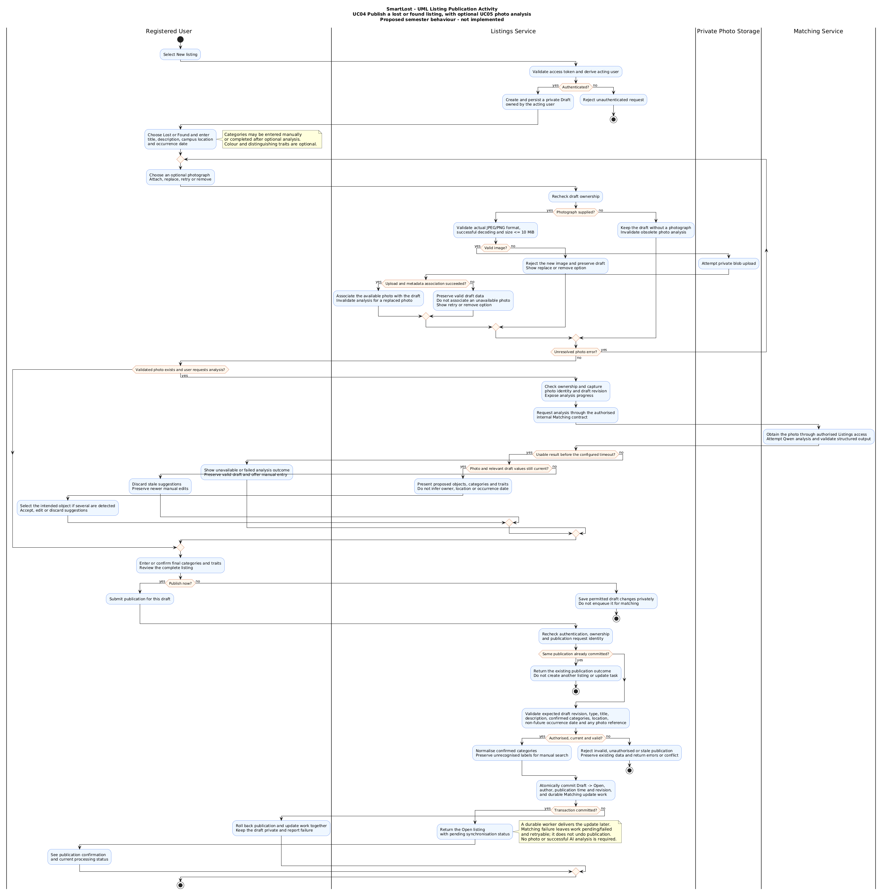
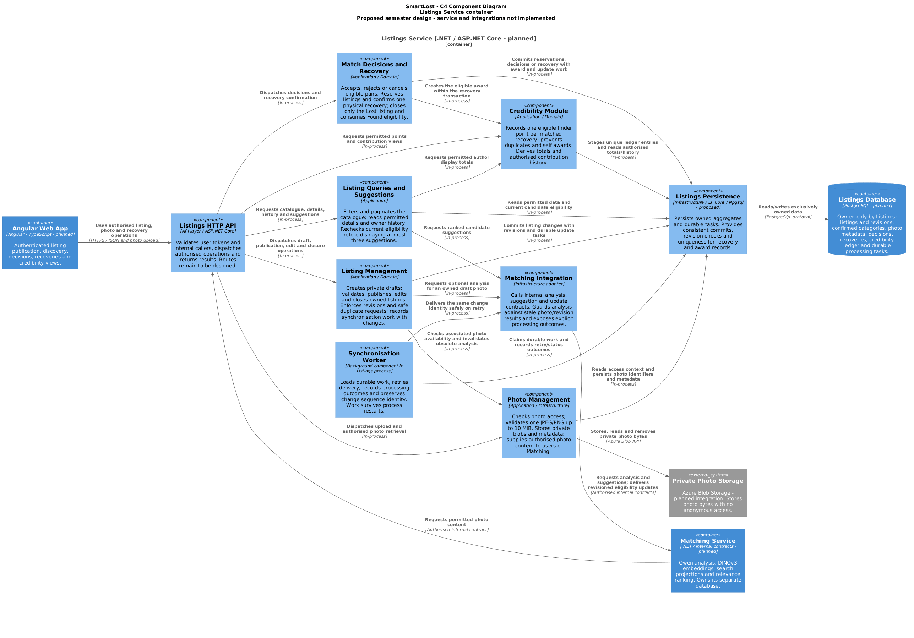
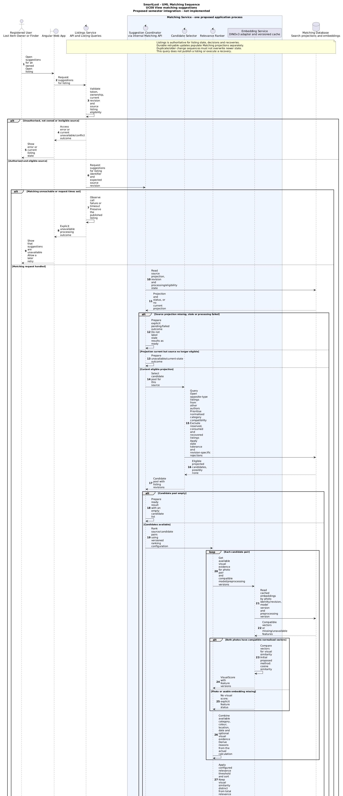
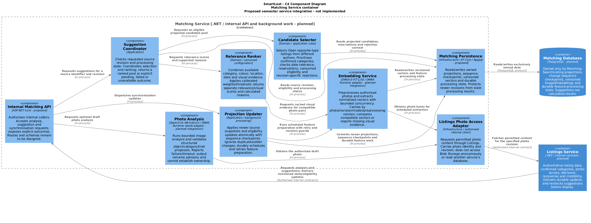
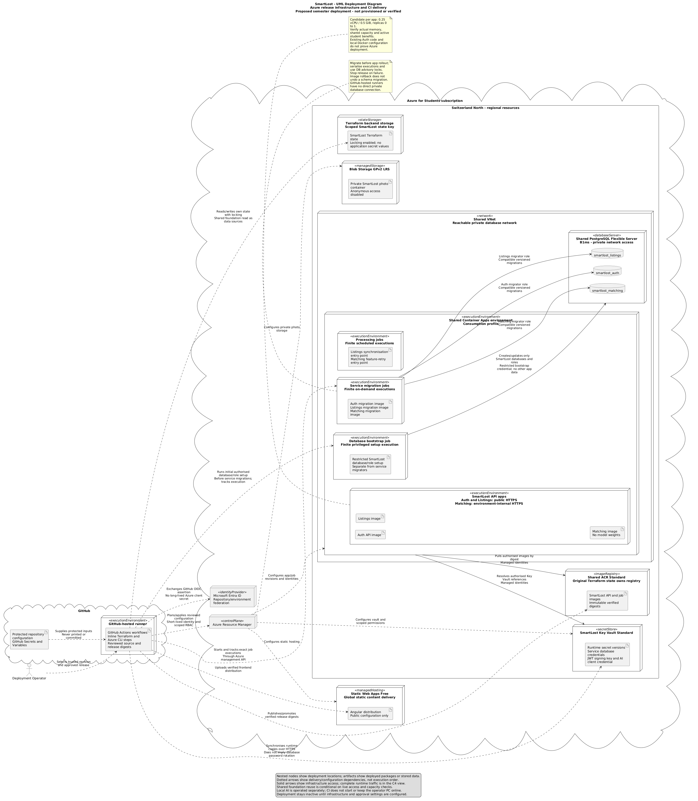
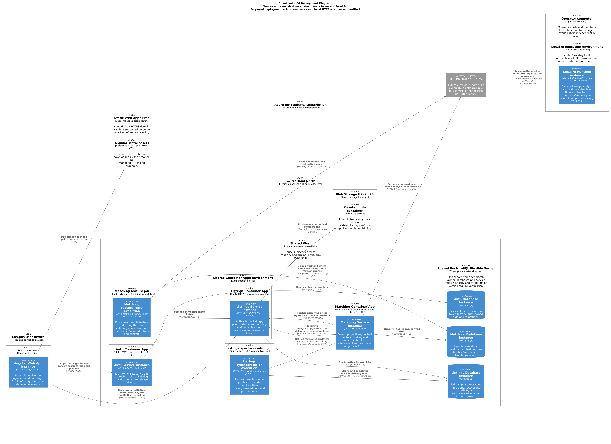

# SmartLost — campus lost and found

A learning project for a campus lost-and-found application that will suggest matches between
listings using editable image-derived categories and photo similarity, with credibility points
for confirmed recoveries. Qwen3-VL-4B-Instruct is selected for traits/categories and DINOv3
ViT-L/16 for image similarity. The selected stack is .NET 10, Angular and PostgreSQL, with
local model inference (ONNX Runtime verified in a standalone CPU experiment; optional NVIDIA CUDA execution is configured but not locally inferred yet; service integration
is not implemented) and Azure Blob Storage for
photos. The repository now includes the first runtime microservice: `SmartLost.AuthService.Api`, a dedicated
authentication API with its own PostgreSQL database, Dockerfile and Compose setup.

## Architecture

The intended architecture separates services by responsibility, with each service owning its
data and communicating through explicit contracts. `SmartLost.AuthService.Api` currently implements that
split with API, Application, Domain and Infrastructure projects, a dedicated PostgreSQL
database connection and JWT issuance. Listings and Matching have buildable project
scaffolds; their application functionality is not implemented.

The [SmartLost project description](docs/SMARTLOST.md) documents the proposed Listings and
Matching services, their data ownership, C4 diagrams, publication/matching flows and credibility
rules. Their behavior remains a design proposal.

Application depends on Domain and its repository/security abstractions; Infrastructure
implements those abstractions. API composes the service. Domain uses framework-free Core
building blocks, Application uses MediatR/validation building blocks, and API uses the
ASP.NET result adapter. Shared libraries never depend on a microservice or own its data.
Repository build configuration applies to microservice projects in the [solution](Aset.slnx).
The solution groups match the physical directories, so Rider's solution view and
VS Code's file explorer show the same service boundaries:

```text
src/
  Services/
    Auth/
      Auth.slnx        # Auth runtime projects, NMF Modeling, shared dependencies and Auth tests
      SmartLost.AuthService.*/
    Listings/
      Listings.slnx    # Runtime scaffolds, NMF Modeling, shared dependencies and model tests
      SmartLost.ListingsService.*/
    Matching/
      Matching.slnx    # Runtime scaffolds, NMF Modeling, shared dependencies and model tests
      SmartLost.MatchingService.*/
  BuildingBlocks/
    BuildingBlocks.slnx
    SmartLost.BuildingBlocks.*/
tests/
  Auth/                # Auth unit and integration test projects
  BuildingBlocks/      # Shared-library unit test project
  Listings/            # Listings NMF model unit test project
  Matching/            # Matching NMF model unit test project
```

Future services belong under `src/Services/<Service>/`, with tests under
`tests/<Service>/` and a focused `<Service>.slnx` beside the service projects.

| Solution | Scope |
| --- | --- |
| [Aset.slnx](Aset.slnx) | All backend projects and tests; the main CI entry point |
| [Auth.slnx](src/Services/Auth/Auth.slnx) | Five Auth runtime projects, NMF Modeling, four BuildingBlocks libraries and the two Auth test projects |
| [Listings.slnx](src/Services/Listings/Listings.slnx) | Four Listings runtime-layer scaffolds, NMF Modeling, four BuildingBlocks libraries and the Listings unit suite |
| [Matching.slnx](src/Services/Matching/Matching.slnx) | Four Matching runtime scaffolds, NMF Modeling, four BuildingBlocks libraries and the Matching unit suite |
| [BuildingBlocks.slnx](src/BuildingBlocks/BuildingBlocks.slnx) | Four shared libraries and their existing unit test project |

Solutions list the same `.csproj` files directly; they do not nest other solutions
or duplicate code. Tests stay physically under `tests/` and appear in the relevant
solution's `Tests` group. Open the focused solution to work on one area, or
`Aset.slnx` to work across the backend. The standalone AI solution remains separate.
Deployment is inactive; see the
[deployment plan](docs/DEPLOYMENT.md).

The runtime layers of Listings and Matching contain only project definitions and documentation. Their API projects
temporarily build as libraries until an entry point is implemented. They have no endpoints,
database contexts, migrations, workers or containers. Service implementations
will use the existing BuildingBlocks; neither service references the other's projects.
Listings and Auth have separate [NMF structural models](src/Services/Listings/SmartLost.ListingsService.Modeling/README.md)
and [Auth model documentation](src/Services/Auth/SmartLost.AuthService.Modeling/README.md).
They contain Ecore sources and generated NMeta/C# representations; Listings also has a sample
publication XMI and a confirmed-recovery XMI. Its seven model classes include decisions,
recoveries and credibility entries; these represent structure, not executable recovery
or point-awarding workflows. Runtime layers do not reference either Modeling project. The dedicated
[Listings unit suite](tests/Listings/SmartLost.ListingsService.UnitTests/README.md) and the Auth
unit suite check their respective models and collect generated-code coverage.

The [current hosting proposal](docs/AZURE_STUDENT_ARCHITECTURE.md) uses globally
distributed static frontend hosting, APIs and persistent data in Switzerland North,
with Qwen/DINOv3 on a local host through an authenticated HTTPS tunnel. It targets up to one month, accepts HTTP
cold starts and accounts for student free benefits shared with SmartRemoteManager.
This deployment and inference integration are not implemented.

### UML and C4 diagrams

Current service communication documentation lives beside each service:
[Auth](src/Services/Auth/COMMUNICATION.md),
[Listings](src/Services/Listings/COMMUNICATION.md) and
[Matching](src/Services/Matching/COMMUNICATION.md). Numbered arrows show interactions;
planned integrations are explicitly marked. Auth includes its outbox worker flow;
Listings and Matching document current model-test interactions; their service integrations remain planned.
Keep these documents current with service changes, or add a specific review note when
communication is unchanged. CI requires the corresponding document change for service
code/configuration/test changes; shared BuildingBlocks implementation or root Compose
changes require reviewing all service diagrams. Reviewers verify semantic accuracy.

The six member pairs below contain the user-provided PNG exports and short English
explanations. Expand a pair to view its images; open an image at full size for details.
Some exports are partial or precede the local AI revision, as noted beside each pair.
The linked PlantUML sources and current hosting proposal describe the latest design.

<details>
<summary>Member 1 — Application goals and system context</summary>

**UML Use Case.** Actors, semester use cases and future extensions, including optional analysis and recovery credibility.



**C4 System Context.** SmartLost, campus users, deployment operator and external systems, with future participants marked.



**Export note.** The supplied context PNG predates the tunnel relay. The current context source includes it; local AI remains part of SmartLost.

[Explanation and editable sources](docs/diagrams/member-1/README.md)

</details>

<details>
<summary>Member 2 — Domain model and application architecture</summary>

**UML Class.** Domain classes, multiplicities, service data ownership and future product concepts.



**C4 Container.** Angular, Auth, Listings, Matching, their databases and private photo storage.



**Export note.** The class PNG predates the latest NMF extensions; its editable source includes source change sequences, current photo selection and embedding preparation tasks. The supplied container PNG shows the earlier model placement inside Matching. The current source separates the local AI runtime and external tunnel; Member 6 shows their deployment.

[Explanation and editable sources](docs/diagrams/member-2/README.md)

</details>

<details>
<summary>Member 3 — Authentication and sessions</summary>

**UML Sequence.** Refresh-token rotation, replay/concurrency rejection and planned current-session sign out.


**C4 Component.** Authentication API, command pipeline, password/session/token services and the Auth-owned database.


**Export note.** The supplied sequence PNG begins at refresh and omits the initial sign-in interaction. The complete UC02 sign-in flow is available in the sequence source.

[Explanation and editable sources](docs/diagrams/member-3/README.md)

</details>

<details>
<summary>Member 4 — Listing publication and Listings Service</summary>

**UML Activity.** Draft creation, optional photo upload/analysis, manual fallback, validation and durable publication.



**C4 Component.** Listings responsibilities for publication, photos, suggestions, recovery, credibility and synchronisation.



**Export note.** The supplied activity PNG groups analysis under Matching. The current activity source also shows inference on the local AI runtime through the authenticated tunnel.

[Explanation and editable sources](docs/diagrams/member-4/README.md)

</details>

<details>
<summary>Member 5 — Matching suggestions and Matching Service</summary>

**UML Sequence.** Suggestion requests, eligible candidate selection, cached visual evidence and relevance ranking.



**C4 Component.** Suggestion coordination, selection, ranking, feature processing, photo access and Matching-owned persistence.



**Export note.** The supplied sequence PNG stops during ranking and omits the final eligibility checks/response. The component PNG predates the local inference client and tunnel. The current sources contain these details.

[Explanation and editable sources](docs/diagrams/member-5/README.md)

</details>

<details>
<summary>Member 6 — Azure delivery and hybrid deployment</summary>

**UML Deployment.** CI delivery, OIDC, Terraform state, registry, Key Vault, database bootstrap and private migration jobs.



**C4 Deployment.** Browser, Azure apps/databases, scheduled jobs and local Qwen/DINOv3 inference through an external HTTPS relay.



**Export note.** These deployment diagrams describe the proposed environment. They do not certify provisioned Azure resources or an operational local HTTP wrapper.

[Explanation and editable sources](docs/diagrams/member-6/README.md)

</details>

## Services/modules

| Module | Responsibility | Documentation |
| --- | --- | --- |
| [`.github/`](.github/) | GitHub Actions workflows, PR/main validation, Coverlet gates, security and container checks | [CI guide](.github/README.md) |
| [`src/Services/Auth/SmartLost.AuthService.Api/`](src/Services/Auth/SmartLost.AuthService.Api/) | Register/login/refresh API, JWT issuance, rotating refresh sessions and an auth-only PostgreSQL database | [Module README](docs/AUTHSERVICE.md) |
| [`src/Services/Auth/SmartLost.AuthService.Worker/`](src/Services/Auth/SmartLost.AuthService.Worker/) | Finite Auth Outbox job delivering versioned public-profile snapshots to configured HTTP receivers | [Worker README](src/Services/Auth/SmartLost.AuthService.Worker/README.md) |
| [`src/Services/Listings/`](src/Services/Listings/) | Runtime scaffold and separate NMF models for listings with change sequences, photos, categories, match decisions, recoveries and credibility entries; runtime functionality pending | [Module README](src/Services/Listings/README.md), [NMF model](src/Services/Listings/SmartLost.ListingsService.Modeling/README.md) |
| [`src/Services/Matching/`](src/Services/Matching/) | Runtime scaffold plus NMF search projections with current photo identity/revision, versioned embeddings and preparation tasks; worker/ranking/client integration pending | [Module README](src/Services/Matching/README.md), [NMF model](src/Services/Matching/SmartLost.MatchingService.Modeling/README.md) |
| [`SmartLost.BuildingBlocks.*`](src/BuildingBlocks/SmartLost.BuildingBlocks.Core/) | Reusable domain/event/result/pagination primitives, application behaviors, HTTP adapters and opt-in EF Core Outbox | [Building blocks guide](docs/BUILDING_BLOCKS.md) |
| [`AIModels/`](AIModels/) | Standalone `AIModels.slnx`; Qwen CPU/NVIDIA CUDA label extraction and DINOv3 CPU/NVIDIA CUDA normalized image embeddings | [AI solution](AIModels/README.md), [Qwen guide](AIModels/Qwen3-VL-4B-Instruct-ONNX/README.md), [DINO guide](AIModels/DINOv3-ViTL16-ONNX/README.md) |

`SmartLost.AuthService.Api` owns its database. Listings and Matching will each own a separate
database; their scaffolds do not create or connect to databases. Cross-service identifiers
will be logical references, without foreign keys between service databases.

## Shared libraries/building blocks

| Project | Responsibility |
| --- | --- |
| `SmartLost.BuildingBlocks.Core` | Type-aware `Entity<TId>`, `AggregateRoot<TId>`, domain-event contracts, domain `Guard`, immutable `Result`/`Result<T>`, errors, explicit domain exceptions, `PageSlice<T>`/`PagedResult<T>` and pagination defaults; no framework dependencies |
| `SmartLost.BuildingBlocks.Application` | Sequential FluentValidation pipeline, reusable `BasePaginatedValidator<T>`/`IPaginatedRequest`, explicit domain-exception mapping, optional transaction behavior, transaction/Outbox contracts and `ICurrentUser` |
| `SmartLost.BuildingBlocks.AspNetCore` | `ToActionResult`, HTTP `ProblemDetails`, sanitized unexpected-error handler, scoped HTTP current-user adapter and API registration |
| `SmartLost.BuildingBlocks.Infrastructure` | Opt-in EF Core Outbox mapping, event staging, leased batch delivery, retry and dead-letter state; each consuming service owns its table and delivery adapter |

See [dependencies, domain primitives, Outbox integration and transaction opt-in](docs/BUILDING_BLOCKS.md).
`AddBuildingBlocksApi()` also registers scoped `ICurrentUser` access to authenticated
user/token claims. Auth already calls this registration; its existing endpoints remain
register/login/refresh. See [current-user usage and claim mapping](docs/BUILDING_BLOCKS.md#current-user-identity).
Auth now uses the shared Outbox library: its EF context saves profile messages atomically
with business changes, and the separate worker performs bounded HTTP delivery. Receiver
routes and a service key must be configured before running the worker. Unit tests cover
profile mapping, the HTTP publisher with a fake handler, bounded worker runs, domain guards
and current-user claims. PostgreSQL integration tests cover atomic Outbox rollback,
identity-version conflicts and competing delivery claims; CI coverage requirements remain unchanged.
AuthService enables exception mapping and validation; it does not enable the transaction
behavior or provide a shared unit-of-work adapter. Its user/session models now use
`AggregateRoot<Guid>`, domain `Guard` checks and service-owned `AuthErrors`; token history
remains an entity. Event collections are ignored by EF; selected profile events are
persisted as Outbox messages, and local session events are cleared after commit. See
[Auth aggregate boundaries and event lifecycle](docs/AUTHSERVICE.md#domain-aggregates-guards-and-events).
[Build defaults](Directory.Build.props),
[build enforcement](Directory.Build.targets), [formatting/naming rules](.editorconfig) and
[NuGet configuration](NuGet.Config) provide the shared repository baseline.

## Local development and containers

Use the .NET SDK specified in [global.json](global.json). Rider, Visual Studio and VS Code
share the repository configuration. CI runs directly in GitHub Actions; no separate local
CI runtime or helper scripts are required.

For focused work, restore and build the selected solution from the repository root:

```sh
dotnet restore src/Services/Auth/Auth.slnx --locked-mode
dotnet build src/Services/Auth/Auth.slnx --no-restore --configuration Release --warnaserror
dotnet restore src/BuildingBlocks/BuildingBlocks.slnx --locked-mode
dotnet build src/BuildingBlocks/BuildingBlocks.slnx --no-restore --configuration Release --warnaserror
```

These commands build the included test projects without executing their tests.
The full-backend CI commands remain in [Quality and CI](#quality-and-ci).

The [local Qwen experiment](AIModels/Qwen3-VL-4B-Instruct-ONNX/README.md) uses ONNX Runtime GenAI
to load a local Qwen3-VL model on CPU or NVIDIA CUDA and extract English JSON object labels from an image using an
[editable prompt](AIModels/Qwen3-VL-4B-Instruct-ONNX/Prompts/image-labels.txt). It belongs to
[`AIModels.slnx`](AIModels/AIModels.slnx), with independent build configuration and commands.
Its source and configuration are versioned; model files and build outputs are ignored.
The AI solution is excluded from CI restore/build/format/test checks; repository-wide security scans still apply.
It has no HTTP API or tunnel configuration.

Both AI projects read model/resource paths and an explicit CPU/CUDA provider from their own ignored `appsettings.json`.
They use the standard .NET JSON configuration provider and a small path resolver.
Copy the adjacent `appsettings.example.json` and edit `Paths` before running them;
the [AI setup guide](AIModels/README.md#build-and-run) provides both copy commands
and path resolution rules. Local settings are copied into build/publish output;
`--model` remains an optional directory override.

The [DINOv3 application](AIModels/DINOv3-ViTL16-ONNX/README.md) in the same solution
loads the community ONNX export on CPU or NVIDIA CUDA and returns a normalized 1024-value image
embedding. It reads the downloaded preprocessing configuration and supports an
interactive image path or a `--model` override. Its Release build succeeded locally;
C# inference and revised float32 preprocessing passed the recorded tolerances
on 15 reference images. From `AIModels/`:

```sh
dotnet run --project DINOv3-ViTL16-ONNX/DinoVision.csproj --configuration Release -- "/absolute/path/to/image.jpg"
```

The DINO community download is pinned to revision
`9f74690bbbba9d76c4cce9062195fc7c95e23bb5`. Required files matched upstream
metadata and passed local checksums/ONNX structural validation on 2026-10-13.
The [model manifest](AIModels/DINOv3-ViTL16-ONNX/model-manifest.json) and
[checksum instructions](AIModels/DINOv3-ViTL16-ONNX/README.md#verify-a-downloaded-copy)
record that verification; it does not establish image-score quality or performance.
The [reference generation](AIModels/DINOv3-ViTL16-ONNX/Validation/README.md) also
completed Python CPU inference on 15 real JPEG/PNG images from `~/models/dataset`,
saving validated input/output arrays under ignored `artifacts/reference/`.
Generated AI validation reports and diagnostics stay in ignored `artifacts/`;
the Python tools enforce this location for output. Model manifests, configuration
examples and dependency locks remain tracked.
The run record pins image checksums and dependency versions. The
C# v2 comparison report under `artifacts/validation/dinov3-csharp-f32-v2-final-2026-10-13/`
records passed decoding/input/runtime/embedding checks with unchanged tolerances;
the failed v1 baseline is retained. Nine local
[preprocessing regression tests](AIModels/DINOv3-ViTL16-ONNX.Tests/README.md) passed.
The local Python validation tools disable ONNX telemetry before initialization;
three full reruns exited normally after a reported intermittent native shutdown abort.
Its exact cause remains unconfirmed; see the
[validation guide](AIModels/DINOv3-ViTL16-ONNX/Validation/README.md#native-shutdown-abort-investigation).
Matching-quality evaluation remains pending.
The latest v3 report also passed 15/15 images; its saved arrays and file identities
were checked. See the [validation guide](AIModels/DINOv3-ViTL16-ONNX/Validation/README.md)
for reference/comparison commands, tolerances, artifact locations and seven Python
checks. Use the DINO `--diagnostics` option to capture binary stages for a single image.
The validation environment now pins Transformers 5.19.0 with synchronized dependencies.
Its 15-image reference/comparison checks and the CI-pinned Trivy filesystem scan passed
locally after the upgrade; hosted CI and container verification remain separate.

Docker-related configuration includes [`.dockerignore`](.dockerignore),
[`docker-compose.yml`](docker-compose.yml) and
[`src/Services/Auth/SmartLost.AuthService.Api/Dockerfile`](src/Services/Auth/SmartLost.AuthService.Api/Dockerfile), plus
[the Auth worker Dockerfile](src/Services/Auth/SmartLost.AuthService.Worker/Dockerfile).
The default stack uses one API container and one PostgreSQL container; the optional
`workers` profile adds a finite Outbox job without an exposed port.
The API image uses locked restore and excludes local settings from its build context.
The standalone `AIModels/` folder is also excluded from the AuthService image build context.
Compose mounts the ignored Docker settings file read-only at runtime.

Copy the JSON setup templates from the repository root:

```sh
cp src/Services/Auth/SmartLost.AuthService.Api/appsettings.example.json src/Services/Auth/SmartLost.AuthService.Api/appsettings.json
cp src/Services/Auth/SmartLost.AuthService.Api/appsettings.Docker.example.json src/Services/Auth/SmartLost.AuthService.Api/appsettings.Docker.json
```

The first file is for local API/EF commands (`Host=localhost`); the second is for Compose
(`Host=auth-db`). PowerShell uses the same paths with `Copy-Item` instead of `cp`.
Local `appsettings*.json` files are ignored by Git; only `appsettings*.example.json` files
are versioned. Replace the JWT signing-key placeholder in local files. Compose's database
uses the documented development-only password in the examples; keep database passwords
consistent if changing the local stack. Share completed JSON settings privately with teammates.
.NET loads configuration directly from JSON; no extra file loader or user-secrets setup is required.

Validate and start the stack:

```sh
docker compose config --quiet
docker compose up -d --wait auth-db
```

Apply the [AuthService CLI migrations](docs/AUTHSERVICE.md#apply-to-a-local-database)
before starting the API, then start the complete stack:

```sh
docker compose up --build
```

Stop the stack:

```sh
docker compose stop
```

Remove the stack:

```sh
docker compose down
```

Remove the stack and volumes **including all local database data**:

```sh
docker compose down -v
```

`stop` preserves containers and data; `down` removes containers/network but preserves the
named database volume. The API URL is `http://localhost:8080` with Docker Compose;
PostgreSQL is exposed on `localhost:5432`.
Local `dotnet run` still uses the launch profile ports in
[`src/Services/Auth/SmartLost.AuthService.Api/Properties/launchSettings.json`](src/Services/Auth/SmartLost.AuthService.Api/Properties/launchSettings.json).

For the optional worker, copy the adjacent `outboxsettings*.example.json` templates and
configure real receiver routes and a service key as described in the
[Worker README](src/Services/Auth/SmartLost.AuthService.Worker/README.md). Local files are
ignored by Git and excluded from image/publish output. After applying Auth migrations:

```sh
docker compose --profile workers config --quiet
docker compose --profile workers run --build --rm auth-outbox-worker
```

This performs a bounded run and exits. Repeat it or schedule it externally; an Azure
schedule has not been deployed. Stop/remove optional-profile containers with
`docker compose --profile workers stop` / `docker compose --profile workers down`.
Volume removal remains destructive.


## Database and migrations

`SmartLost.AuthService.Api` owns the `authservice` PostgreSQL database. The service uses EF Core with a
dedicated connection string named `AuthDatabase`. Its [Infrastructure migrations](src/Services/Auth/SmartLost.AuthService.Infrastructure/Persistence/Migrations/)
contain `InitialCreate`, which creates `Users` and the unique normalized-identity indexes,
`AddRefreshTokens`, which creates per-login sessions and hashed refresh-token history,
and `AddAuthOutbox`, which adds `OutboxMessages` and the user identity-version column.
Apply the latest migration before starting either updated Auth process.
The `Users` mapping lives in [UserAccountConfiguration](src/Services/Auth/SmartLost.AuthService.Infrastructure/Persistence/Configurations/UserAccountConfiguration.cs);
`AuthDbContext` applies service entity configurations and the shared Outbox mapping.
The API and worker share only this Auth-owned database; they are two processes of the same service.
Migrations are applied explicitly through `dotnet ef database update` before starting the
API, including with Compose. API startup does not create or migrate the schema in any environment.
Each future service must own its context, migrations and database; there are no cross-service
foreign keys or shared service migrations.

Restore the repository's pinned EF Core 10.0.12 tool and inspect migrations without a database:

```sh
dotnet tool restore
dotnet ef migrations list --no-connect --project src/Services/Auth/SmartLost.AuthService.Infrastructure --startup-project src/Services/Auth/SmartLost.AuthService.Infrastructure --context AuthDbContext
dotnet ef migrations has-pending-model-changes --project src/Services/Auth/SmartLost.AuthService.Infrastructure --startup-project src/Services/Auth/SmartLost.AuthService.Infrastructure --context AuthDbContext
```

The [AuthService database guide](docs/AUTHSERVICE.md#database-and-migrations) contains
connection setup, migration creation/application and SQL generation commands. Design-time
commands use the Infrastructure factory without running API startup. Migration
application is an explicit operation; no deployment workflow is active.

The checked-in EF migrations are the source of truth. See
[manual application commands](docs/AUTHSERVICE.md#apply-the-refresh-token-migration-yourself).
Generate SQL on demand for review; SQL exports do not need to be committed.

## API surface

`SmartLost.AuthService.Api` exposes these endpoints:

| Method | Route | Description |
| --- | --- | --- |
| `POST` | `/api/auth/register` | Creates a new user and returns access/refresh tokens |
| `POST` | `/api/auth/login` | Authenticates by email and password and creates a token session |
| `POST` | `/api/auth/refresh` | Rotates a refresh token and returns a new access/refresh pair |

Login accepts `{ "email": "user@example.com", "password": "your-password" }`.
Email matching trims whitespace and ignores casing.
Registration requires unique usernames and emails after trimming and case normalization.
Duplicates return HTTP 409, including database conflicts during concurrent registrations.

In Development, Swagger UI is available at `/swagger` and uses the OpenAPI document at
`/openapi/v1.json`. Open `http://localhost:8080/swagger` with Compose or
`http://localhost:5048/swagger` with the local HTTP launch profile to test endpoints using
**Try it out**. Both documentation routes are disabled outside Development.
Success bodies include `userId`, `userName`, `email`, `accessToken`, `expiresAtUtc`,
`refreshToken` and `refreshTokenExpiresAtUtc` (register: 201; login/refresh: 200).
Refresh accepts `{ "refreshToken": "the-latest-issued-token" }` without a valid access token.
Refresh sessions expire after seven days by default (`Jwt:RefreshTokenExpiryDays`, range 1–90);
rotation preserves that absolute expiry. Reusing an old token revokes its whole session.
Expiry values use PostgreSQL's microsecond precision consistently in responses and storage.
See [refresh token behavior and migration scripts](docs/AUTHSERVICE.md#refresh-tokens).
Refresh-token tests use isolated SQLite databases for rotation, expiry, replay and competing
updates; they do not apply migrations to the local PostgreSQL database.
Application failures use `application/problem+json` with an error code, trace identifier and
field errors when applicable (400 validation, 409 duplicate account, 401 invalid credentials).
Malformed request bodies use ASP.NET validation problems. Unexpected exceptions return a
sanitized 500 problem and are logged server-side.

## Quality and CI

| Area | Current configuration |
| --- | --- |
| SDK / target | SDK **10.0.401** pinned exactly in `global.json` and the Docker build image; `SmartLost.AuthService.Api` targets `net10.0`; the runtime image uses `aspnet:10.0` |
| Style / analysis | `.editorconfig`, .NET 10 recommended analyzers, nullable references, warnings as errors |
| Dependencies | Locked restore and direct/transitive NuGet auditing; lock files required with projects; local `dotnet-ef` 10.0.12 and `NMF-Ecore2Code` 2.0.467 pinned in `.config/dotnet-tools.json`; Auth and Listings Modeling reference `NMF-Basics` 2.0.467 |
| Tests / coverage | All tests must pass; unit tests check Auth migration/model drift, PostgreSQL SQL generation and the NMF Auth and Listings models; **Coverlet** collects unit line coverage; inline workflow gates require **strictly above 80%** overall and on changed executable code; declaration-only interfaces, enums and const-only static classes are recognized regardless of location |
| Security | Configured Gitleaks history/file scans with redacted diagnostics and one exact historical test-placeholder exception in [`.gitleaksignore`](.gitleaksignore); Trivy dependency, infrastructure and image scans; checksum-pinned tools |
| Dependency updates | [Weekly Dependabot configuration](.github/dependabot.yml) for Actions, NuGet and Docker |

The configured workflows are:

- [CI](.github/workflows/ci.yml): validates one current revision per run: the PR merge
  candidate, the latest push to `main`, or the merge-group/manual target. New commits on a
  PR cancel its superseded runs. Feature-branch pushes need an open PR to trigger CI.
  The aggregate **`CI / Required`** gate requires all validation stages to pass; there are
  no path filters. Job labels show a short commit ID and title.
  Target selection also checks service communication document presence and requires
  diagram updates or review notes alongside affected service changes. This read-only
  check never generates or commits documentation.
- [Validate commit](.github/workflows/validate-commit.yml): builds, checks formatting/analyzers,
  and runs unit tests on Linux, Windows and macOS for `Aset.slnx`; runs integration tests on Linux; then runs
  workflow/security scans and builds/scans any `SmartLost.*/Dockerfile`, retaining image archives
  and SBOMs.

The workflow executes these exact commands once projects exist (run from the repository root):

```sh
dotnet restore Aset.slnx --locked-mode -p:NuGetAudit=true -p:NuGetAuditMode=all -p:NuGetAuditLevel=low -p:TreatWarningsAsErrors=true
dotnet build Aset.slnx --no-restore --configuration Release --warnaserror
dotnet format Aset.slnx --no-restore --verify-no-changes --severity info
```

AuthService integration tests require a running Docker engine. Testcontainers starts isolated
PostgreSQL 16, applies EF migrations only there, resets data between tests and removes the
container afterward. The suite runs the API in `Testing`, using Npgsql and test-only settings;
it does not use the development database or EF's in-memory provider. See the
[integration test guide](tests/Auth/SmartLost.AuthService.IntegrationTests/README.md).
Reusable request/seeding helpers use scoped EF contexts; connection-isolation tests verify
independent connections while another scope has an active reader.

The current test commands are:

```sh
dotnet test tests/Auth/SmartLost.AuthService.UnitTests/SmartLost.AuthService.UnitTests.csproj --no-build --no-restore --configuration Release --logger trx --results-directory artifacts/tests/unit/SmartLost.AuthService.UnitTests --collect:"XPlat Code Coverage" --settings coverage.runsettings
dotnet test tests/BuildingBlocks/SmartLost.BuildingBlocks.UnitTests/SmartLost.BuildingBlocks.UnitTests.csproj --no-build --no-restore --configuration Release --logger trx --results-directory artifacts/tests/unit/SmartLost.BuildingBlocks.UnitTests --collect:"XPlat Code Coverage" --settings coverage.runsettings
dotnet test tests/Listings/SmartLost.ListingsService.UnitTests/SmartLost.ListingsService.UnitTests.csproj --no-build --no-restore --configuration Release --logger trx --results-directory artifacts/tests/unit/SmartLost.ListingsService.UnitTests --collect:"XPlat Code Coverage" --settings coverage.runsettings
dotnet test tests/Matching/SmartLost.MatchingService.UnitTests/SmartLost.MatchingService.UnitTests.csproj --no-build --no-restore --configuration Release --logger trx --results-directory artifacts/tests/unit/SmartLost.MatchingService.UnitTests --collect:"XPlat Code Coverage" --settings coverage.runsettings
dotnet test tests/Auth/SmartLost.AuthService.IntegrationTests/SmartLost.AuthService.IntegrationTests.csproj --no-build --no-restore --configuration Release --logger trx --results-directory artifacts/tests/integration/SmartLost.AuthService.IntegrationTests
```

Coverlet configuration and the inline coverage/test gates are documented in the
[CI guide](.github/README.md#local-net-commands).
Empty scaffold projects participate in inventory, locked restore, build and formatting.
The coverage assembly check requires reports once a project has C# compile items; the
strictly-above-80% overall and changed-code gates remain in place.
Coverage file paths and project directories use the same separators on Linux, Windows and macOS.
The Listings and Matching unit suites cover their generated NMF implementations. Pure interfaces, enums
and const-only static classes are recognized as declarations; executable generated code remains covered by
the existing gates.
Collection settings live in [coverage.runsettings](coverage.runsettings).
After adding projects, apply formatting locally with `dotnet format Aset.slnx`.

The [main ruleset](.github/main-ruleset.json) is checked in; **activation on GitHub has not been verified**.
It requires an up-to-date PR, an independent approval, resolved discussions and `CI / Required`,
and blocks force-push/deletion. An administrator must complete [GitHub setup](docs/GITHUB_SETUP.md).
Workflow files exist, but a successful hosted CI run has not been verified. No deployment or
README-writing workflow is active; the [deployment template](docs/examples/deploy.yml) is
outside `.github/workflows/` and its unfinished inline steps fail until implemented.

## Development conventions

AuthService uses AutoMapper 16.2.0 to map API request DTOs to Application commands.
Profiles are registered through the API's `AddApiMapping` extension; domain entities retain their factory
methods and invariants. See [mapping setup](docs/AUTHSERVICE.md#object-mapping).

Use PascalCase types/methods, `I`-prefixed interfaces, camelCase locals/parameters, `_camelCase`
private fields, Allman braces, four spaces and file-scoped namespaces. Detailed enforced rules
and review conventions are in [coding standards](docs/CODING_STANDARDS.md).
MediatR commands return `Result<T>` for expected business failures. FluentValidation checks
commands before handlers execute, including direct mediator calls; validators run sequentially.
Paginated queries can implement `IPaginatedRequest` and derive their validator from
`BasePaginatedValidator<T>`: `PageIndex` starts at zero and `PageSize` must be 1–100.
Repository pagination returns `PageSlice<T>` with the total filtered count before paging;
applications can map it to `PagedResult<TDto>`. These utilities have no consuming endpoint yet.
Only explicit `DomainException` errors become results; generic exceptions and cancellation
propagate. HTTP success codes belong to endpoints, not application results.

AuthService centralizes username/email lookup normalization in its Domain using
`Trim().ToUpperInvariant()`. `UserAccount.Create` derives both normalized keys, and
`ChangeIdentity` updates original values and keys together after validating both inputs.
Display values retain their casing; normalized columns have unique database indexes.
See [identity conventions](docs/AUTHSERVICE.md#user-identity-normalization).

Microservice projects live under `src/Services/<Service>/`, shared libraries under
`src/BuildingBlocks/`, and tests under `tests/<Service>/` or `tests/BuildingBlocks/`.
All appear in `Aset.slnx`, have unique names and commit their
package locks. Production code requires both unit and integration test projects.
Standalone AI applications live under `AIModels/` and appear only in `AIModels.slnx`, with
their own configuration and package locks. CI excludes this folder from project inventory and
restore/build/format/test checks. Repository-wide security scans still apply; AI inference is checked locally.
See [adding the first service](.github/README.md#adding-the-first-service).
Follow [AGENTS.md](AGENTS.md): update this README and the affected module README in the same
change as code/configuration, using relative links and verified, secret-safe examples.

## Further reading

- [Design patterns used in the project, source evidence and six-member presentation allocation](docs/DESIGN_PATTERNS.md)
- [Separate design pattern presentation folders for members 1–6](docs/design-patterns/README.md)
- Requirements analysis for the semester MVP, Azure delivery and future UML/C4 modelling: [Google Docs](https://docs.google.com/document/d/1AYPYDg9ku5bWQCnwcyzXk9HWsxV3w5WU/edit)
- [Member 1 UML Use Case and C4 System Context diagrams](docs/diagrams/member-1/README.md)
- [Member 2 UML Class and C4 Container diagrams](docs/diagrams/member-2/README.md)
- [Member 3 authentication UML Sequence and C4 Component diagrams](docs/diagrams/member-3/README.md)
- [Member 4 publication UML Activity and Listings C4 Component diagrams](docs/diagrams/member-4/README.md)
- [Member 5 matching UML Sequence and C4 Component diagrams](docs/diagrams/member-5/README.md)
- [Member 6 Azure UML Deployment and hybrid C4 Deployment diagrams](docs/diagrams/member-6/README.md)
- [SmartLost description, proposed C4 architecture and user flow](docs/SMARTLOST.md)
- [Repository agent and documentation rules](AGENTS.md)
- [Infrastructure, coverage and contributor onboarding](.github/README.md)
- [C# coding standards](docs/CODING_STANDARDS.md)
- [GitHub protections and security setup](docs/GITHUB_SETUP.md)
- [Deployment plan and activation requirements](docs/DEPLOYMENT.md)
- [Azure student resource/CI proposal and USD 100 budget assumptions](docs/AZURE_STUDENT_ARCHITECTURE.md)
- [AuthService module README](docs/AUTHSERVICE.md)
- [Shared building blocks and reuse guide](docs/BUILDING_BLOCKS.md)
- [Standalone AI solution and local inference](AIModels/README.md)

The auth service database schema and API surface are documented above. The SmartLost description
still includes the proposed implementation sequence for future services.
