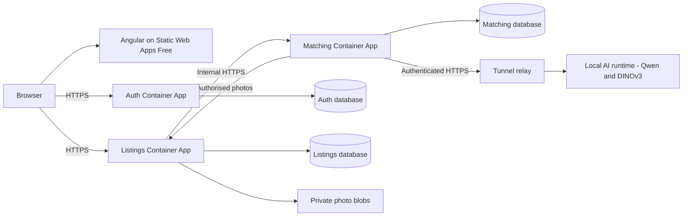

# SmartLost Azure and local AI architecture

Status: **proposal, not deployed**. Updated **17 October 2026** after the user selected
Switzerland North, local AI through a tunnel, at most one month in the same student
subscription as SmartRemoteManager, and HTTP cold starts after inactivity.
This replaces the earlier Azure VM proposal and its multi-month cost assumptions.

## Recommended resources

Use **Static Web Apps Free, three lightweight Container Apps Consumption apps,
private PostgreSQL databases, private Blob Storage and Key Vault**. Qwen and
DINOv3 execute on the user's computer; cloud Matching owns projections, cached
vectors, relevance calculation and processing state.

Prefer reusing the existing SmartRemoteManager foundation below. Its Terraform
configuration was inspected, but live existence, permissions, benefit coverage
and spare capacity have not been authenticated. Shared resources remain owned
by their original Terraform state; read them as data sources in SmartLost.
No reference-project file or resource was modified.

| Resource | SmartLost use | Cost and ownership |
| --- | --- | --- |
| Static Web Apps Free | Angular and Azure-provided HTTPS domain | No purchased domain. Browser calls API origins with explicit CORS; no paid managed API linking assumed. |
| Existing Container Apps environment/VNet | Auth, Listings and Matching apps | Reuse shared networking to avoid duplicating fixed environment infrastructure charges. |
| Auth Container App | Existing API, planned sign out | Initial candidate 0.25 vCPU / 0.5 GiB, min replicas 0, max 1; public HTTPS ingress. Verify memory fit. |
| Listings Container App | Listings, photos, decisions, recovery, credibility | Same initial compute envelope and public HTTPS ingress; ownership checks remain server-side. |
| Matching Container App | Projections, cached vectors, ranking and AI client | Same initial envelope; internal HTTPS ingress within the environment. No model weights loaded in Azure. |
| Existing PostgreSQL B1ms | Three new logical databases and distinct roles | Proposed names smartlost_auth, smartlost_listings, smartlost_matching. Separate ownership and migrations; no shared tables or cross-service foreign keys. |
| Existing ACR Standard | Separate SmartLost image repositories, digest releases | Check its 12-month benefit. Do not create Basic merely because Standard's retail price is higher. |
| Private GPv2 LRS storage | Application-specific photo container | Check covered storage/operation meters; only Listings controls photo bytes. No Azure AI VM disk or model storage is needed. |
| SmartLost Key Vault Standard | Runtime copies of GitHub Secrets | Prefer a separate vault and per-identity access so the other application's secrets stay isolated. |
| Managed identities | Apps and finite jobs | Scoped registry, secret and storage access. CI uses OIDC, not a long-lived Azure client secret. |
| Container Apps Jobs | Private migrations and bounded processing retries | Reuse the environment/VNet and terminate each execution. No permanent replica solely for DB polling. |
| Terraform state Blob | Unique state container/key and locking | Existing backend account may be reused with scoped access; never co-own resources in two states. |

Static Web Apps distributes static assets globally; Switzerland North describes
the regional backend/data target, not exclusive frontend content residency.
Validate the supported Static Web Apps resource location before provisioning.
See Microsoft's [global hosting explanation](https://learn.microsoft.com/en-us/azure/static-web-apps/faq#how-do-i-ensure-my-app-is-deployed-to-a-specific-azure-region).

A shared PostgreSQL server requires capacity checks alongside SmartRemoteManager.
Use small service connection pools and no warm minimum; release connections while
waiting for inference. Do not alter the other application's tables or grants.
The reference targets PostgreSQL 17 while Auth integration fixtures currently use
16; validate the actual target major version before claiming compatibility.

## Benefits before credit consumption

Calculate **12-month monthly allowances**, **ongoing free grants** and **chargeable
usage deducted from credit** separately. Benefits are not duplicated per project.

| Service | Relevant published allowance | Calculation rule |
| --- | --- | --- |
| ACR Standard | One Standard registry with 100 GB and 10 webhooks for 12 months | Existing eligible registry usage within the allowance can be free. USD 0.6666/day is its retail fallback, not necessarily its student bill. |
| PostgreSQL Flexible Server | 750 B1ms hours/month, 32 GB storage and 32 GB backup for 12 months | Share one eligible server within its limits; three databases do not confer three server allowances. |
| Container Apps Consumption | 180,000 vCPU-seconds, 360,000 GiB-seconds and 2 million requests/month | Ongoing grant shared with SmartRemoteManager and jobs. Scale-to-zero does not remove networking or log charges. |
| Static Web Apps Free | Ongoing Free plan with included HTTPS | Check actual size/bandwidth limits and use direct API calls with CORS. |
| Blob Storage / Key Vault | Limited introductory allowances in the general free-service catalogue | Confirm actual subscription eligibility and covered meters before setting cost to zero. |
| Networking and logging | Not made free by the Container Apps compute grant | Shared load-balancer/IP and log charges still count on the subscription bill. |

The introductory period starts with the account benefit, not a new deployment.
Student credit renewal alone does not prove renewed 12-month benefit eligibility.
Check **Free services** usage and Cost Analysis for both projects together.

Sources: [Azure for Students](https://azure.microsoft.com/en-us/free/students/),
[free-service eligibility](https://azure.microsoft.com/en-us/pricing/free-services/),
[Container Apps billing](https://learn.microsoft.com/en-us/azure/container-apps/billing)
and [Static Web Apps plans](https://learn.microsoft.com/en-us/azure/static-web-apps/plans).

### Illustrative one-month incremental cost

Public Switzerland North rates from the
[Retail Prices API](https://learn.microsoft.com/en-us/rest/api/cost-management/retail-prices/azure-retail-prices)
are saved in [the rate snapshot](azure-student-retail-prices.json).
A 0.25 vCPU / 0.5 GiB app costs **USD 0.027 per active hour before free grants**.
Three apps active 20 hours each, plus two 30-second finite workers scheduled every
15 minutes, yield approximately **USD 2.92 gross compute** for 30 days. Durations
are assumptions, not benchmarks; startup and inference waiting count.

Spare subscription grants may cover this compute. Use **USD 5 to 10 incremental
spend as a planning target**, including modest storage/logging/traffic, subject
to deployment measurements. It is not a quote or hard cap. Existing foundation
charges are not zero because they are reused. Compare the combined bill with the
measured SmartRemoteManager baseline; local Terraform is not an actual invoice.

## Local inference and availability

The local runtime belongs to SmartLost; the relay is an external dependency.
Require a service secret/token, bounded concurrency/timeouts and fixed inference
operations. A tunnel URL is not a credential. Send permitted image bytes, not
database/admin credentials or unrestricted storage access. Limit temporary file
lifetime and return model/preprocessing versions. Image text is content, not
instructions. Only Matching calls this runtime; never the browser.

A free **ngrok development domain** is a candidate without buying a domain; it
provides HTTPS and currently includes 1 GB transfer out and 20,000 requests/month.
Verify actual usage/limits. Microsoft Dev Tunnels with a persistent authenticated
URL is another option; account for token management and its preview status.
No tunnel account or endpoint was created here.

When the PC/tunnel is offline, cloud accounts, listings, photos, recovery and
credibility continue operating. Suggestions use cached vectors/metadata; new
analysis or extraction reports unavailable/pending and retries safely. Offline
AI must not make cloud core readiness fail. Complete AI acceptance still requires
an actual inference run through the tunnel with recorded versions and results.

The AI projects are console experiments without HTTP endpoints. The runtime
wrapper, caller authentication and local process/tunnel startup are planned.
CI can publish its versioned artifact; a GitHub-hosted runner cannot keep the
user's computer awake or maintain that local process.

Sources: [ngrok free limits](https://ngrok.com/docs/pricing-limits/free-plan-limits),
[Dev Tunnels](https://learn.microsoft.com/en-us/azure/developer/dev-tunnels/overview)
and [Container Apps ingress](https://learn.microsoft.com/en-us/azure/container-apps/ingress-overview).

## CI and migration design

All workflows below are **planned**. Keep orchestration in GitHub Actions YAML
with inline native shell steps, preserving current required CI/security/coverage.

1. **Preflight:** trusted-main OIDC; verify shared resources, Switzerland North,
   permissions, active benefits, spare grants and server capacity before apply.
2. **Terraform plan/apply:** reviewed saved plan bound to source/configuration,
   remote locking and serialised mutations. Shared foundation is data, not a
   second managed copy. Provision only SmartLost resources.
3. **Secret sync:** validate GitHub inputs and transfer runtime copies to Key
   Vault without printing values. Protect temporary files and report partial
   failure. No secret values in image layers or ordinary Terraform state.
4. **Publish:** promote scanned immutable images from the successful protected-main
   CI revision, with SBOMs and source provenance. No rebuild between verification
   and deployment.
5. **Migrate:** service-owned finite migration images/bundles run as Container
   Apps Jobs in the shared VNet. Track the exact execution with bounded waits.
   GitHub-hosted runners need no public database access.
6. **Deploy/verify:** configure managed identities/Key Vault references, deploy
   reviewed digests, upload Angular and set API origins/CORS. Verify cloud core
   health and the critical flow; record local AI availability separately.
   Failed rollout restores recorded healthy digests but remains a failed release.

Only Auth has migrations today. Each service gets separate schema/migrator and
runtime CRUD roles; bootstrap modifies only SmartLost databases. Use database
advisory locks as well as workflow serialisation. Apply pending migrations with
history, never EnsureDeleted or automatic downgrade. A partial multi-service
migration failure stops release; image rollback does not revert a schema.

With min replicas 0, a polling loop cannot wake a stopped application. Use finite
Listings synchronisation and Matching feature-work jobs on bounded schedules
with durable retry/backoff. Auth now also has a finite Outbox executable and service-owned migration, but its receiver
and schedule are not deployed. Add a separate Auth delivery job when that consumer exists.
Initial 15-minute schedules for the planned Listings/Matching jobs recover pending work;
warm interactive processing can provide faster results. Final cadence and limits
depend on measurements. Do not repeatedly launch expensive work for an offline PC.

## GitHub configuration

| Location | Settings |
| --- | --- |
| Variables | Azure client/tenant/subscription IDs; switzerlandnorth; shared environment/server/registry IDs; unique state backend/key; public API origins; JWT issuer/audience; AI_INFERENCE_BASE_URL; release/contract versions; DEPLOYMENTS_ENABLED |
| Secrets | Separate service runtime/migrator passwords; restricted DB bootstrap credential where needed; JWT_SIGNING_KEY; AI_INFERENCE_API_KEY or selected client token; tunnel-agent credential if centrally managed |

GitHub -> Key Vault -> authorised runtime/job is the secret path. Existing Auth
uses **Jwt__SigningKey**, not the reference application's different key name.
The local host uses an authorised Key Vault user login or protected local store;
GitHub cannot return saved Secret values for local download. Only public API
origins/configuration go into Angular. Secret sync is not automatic DB password
rotation. Provisioning passwords through Terraform requires verified supported
ephemeral/write-only arguments, not sensitive=true alone.

One initial trusted OIDC/state/RBAC bootstrap is needed: another repository is
not automatically authorised by an existing federation. Then infrastructure,
secrets, migrations and releases run from CI. Deployment remains disabled until
the real infrastructure and protected GitHub environment settings are configured.

## Documentation and evidence

[Member 6's UML and C4 deployment sources](diagrams/member-6/README.md) map this
proposal to release infrastructure and cloud/local runtime instances. They are
editable PlantUML diagrams, not evidence of provisioned resources.

The requirements and affected text diagrams must represent cloud Matching calling
an explicit local AI runtime through an external relay. The earlier exclusive
Azure-inference requirement is superseded by the user's choice.

Inspected: repository code/CI/containers, SmartRemoteManager Terraform/workflows,
official offers and public retail rates. Not performed: authenticated Azure
benefit/capacity checks, shared resource mutation, Terraform plan/apply,
deployment, migrations, inference or application tests.

Additional references: [Azure OIDC](https://learn.microsoft.com/en-us/azure/developer/github/connect-from-azure-openid-connect),
[runtime secrets](https://learn.microsoft.com/en-us/azure/container-apps/manage-secrets),
[finite jobs](https://learn.microsoft.com/en-us/azure/container-apps/jobs),
[VNet infrastructure charges](https://learn.microsoft.com/en-us/azure/container-apps/custom-virtual-networks#managed-resources)
and [Terraform write-only data](https://developer.hashicorp.com/terraform/language/manage-sensitive-data/write-only).
