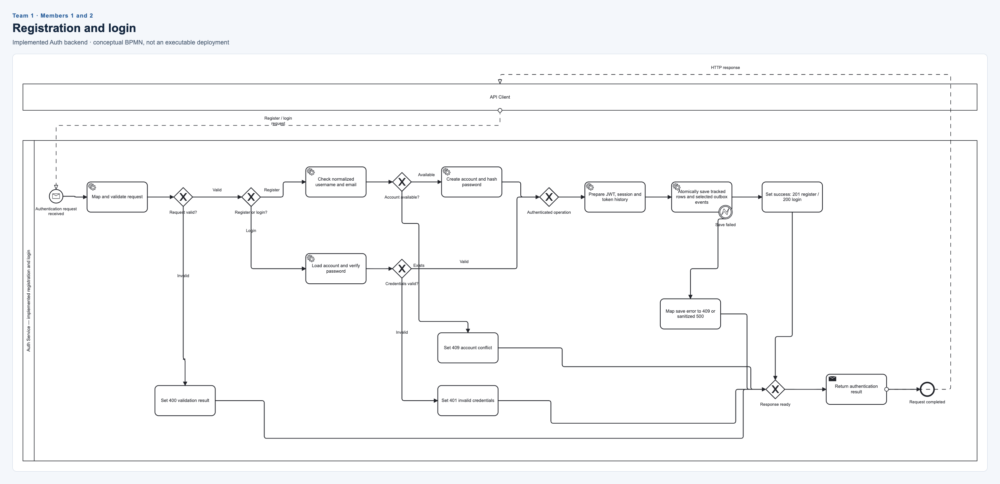

# Team 1 Authentication

**Members:** 1 and 2. **Status:** implemented registration/login backend, represented
as a non-executable BPMN model. Refresh and outbox delivery are outside this diagram.

[Editable BPMN](authentication.bpmn) · [SVG](authentication.svg) · [PNG](authentication.png)

| Member | Assigned responsibility |
| --- | --- |
| 1 | Explain validation, registration/login branches and their source-code participants. |
| 2 | Explain error results, the atomic save, response merging and review the notation. |

## Flow to present

- Validate the request; invalid data returns 400.
- Registration checks duplicate identity, creates the account and hashes its password.
- Login loads the account and checks credentials; unknown users and wrong passwords return the same 401 result.
- Prepare JWT/session/token history; save tracked data and selected outbox messages atomically.
- Return tokens only after a successful save. Duplicate/save errors map to the appropriate error result.

The database-save boundary event abstracts existing exception/result handling; it
does not imply an installed BPMN engine. The diagram groups low-level calls into
business steps. Registration returns 201 and login 200; no Angular implementation
or receiver service is implied.

## Source evidence

- [AuthController](../../../src/Services/Auth/SmartLost.AuthService.Api/Controllers/AuthController.cs)
- [Registration handler](../../../src/Services/Auth/SmartLost.AuthService.Application/Commands/Register/RegisterUserCommandHandler.cs) and [login handler](../../../src/Services/Auth/SmartLost.AuthService.Application/Commands/Login/LoginUserCommandHandler.cs)
- [Session creation](../../../src/Services/Auth/SmartLost.AuthService.Infrastructure/Authentication/AuthenticationSessionService.cs) and [atomic outbox staging](../../../src/Services/Auth/SmartLost.AuthService.Infrastructure/Persistence/AuthDbContext.cs)

Actual names and contribution/commit links: **to be filled in by the pair**.

[All teams and editing instructions](../README.md)
