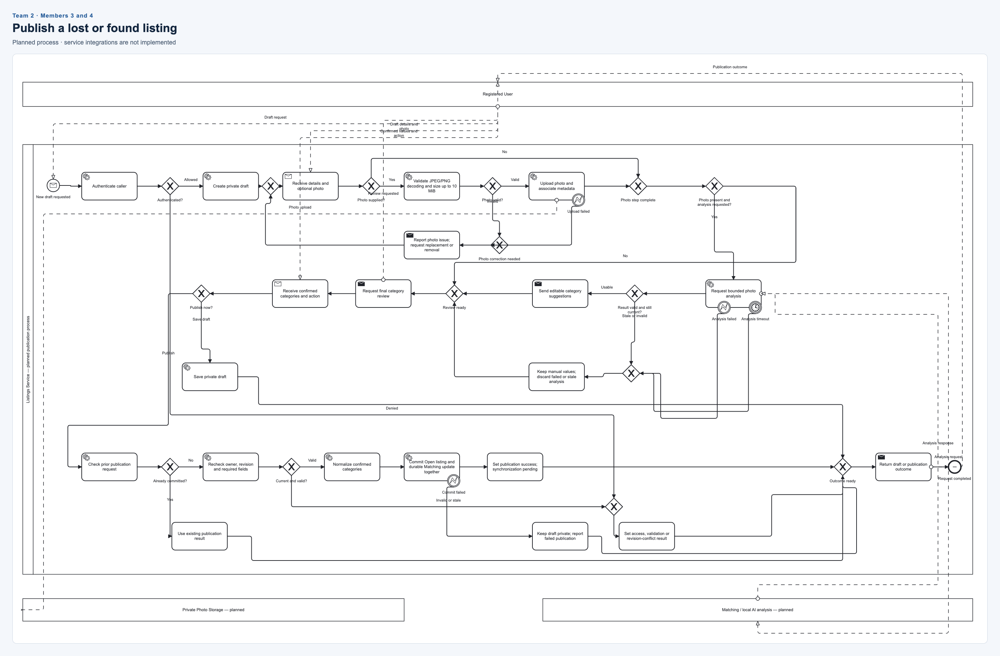

# Team 2 Listing publication

**Members:** 3 and 4. **Status:** planned process; the generated Listings model does
not implement this workflow.

[Editable BPMN](listing-publication.bpmn) · [SVG](listing-publication.svg) · [PNG](listing-publication.png)

| Member | Assigned responsibility |
| --- | --- |
| 3 | Explain draft creation, optional photo validation/upload and the correction loop. |
| 4 | Explain optional analysis, manual fallback, publication checks and atomic commit/failure paths. |

## Flow to present

- Authenticate the user, create a private draft and receive details plus an optional photo.
- Validate JPEG/PNG decoding and the 10 MiB size limit. Invalid photos or upload failures return to correction; the user can remove the photo.
- If requested, obtain bounded analysis through Matching. Timeout, failure or stale output falls back to manual values.
- Ask the user to confirm categories and choose save-draft or publish.
- For publication, check idempotency, ownership, revision and required fields.
- Commit the Open listing and durable Matching update together, or keep the draft private on failure.

The user, photo storage and analysis provider are separate participants connected
by message flows. AI analysis is optional and never overrides user confirmation.
Publishing does not wait for the later Matching synchronization worker; that worker
is outside this process. Timer expressions are symbolic, not selected timeout values.

## Design evidence

- [Existing publication activity](../../../docs/diagrams/member-4/smartlost-publication-activity.puml)
- [Listings design interpretation](../../../docs/diagrams/member-4/README.md)
- [Current Listings implementation status](../../../src/Services/Listings/README.md)

Actual names and contribution/commit links: **to be filled in by the pair**.

[All teams and editing instructions](../README.md)
