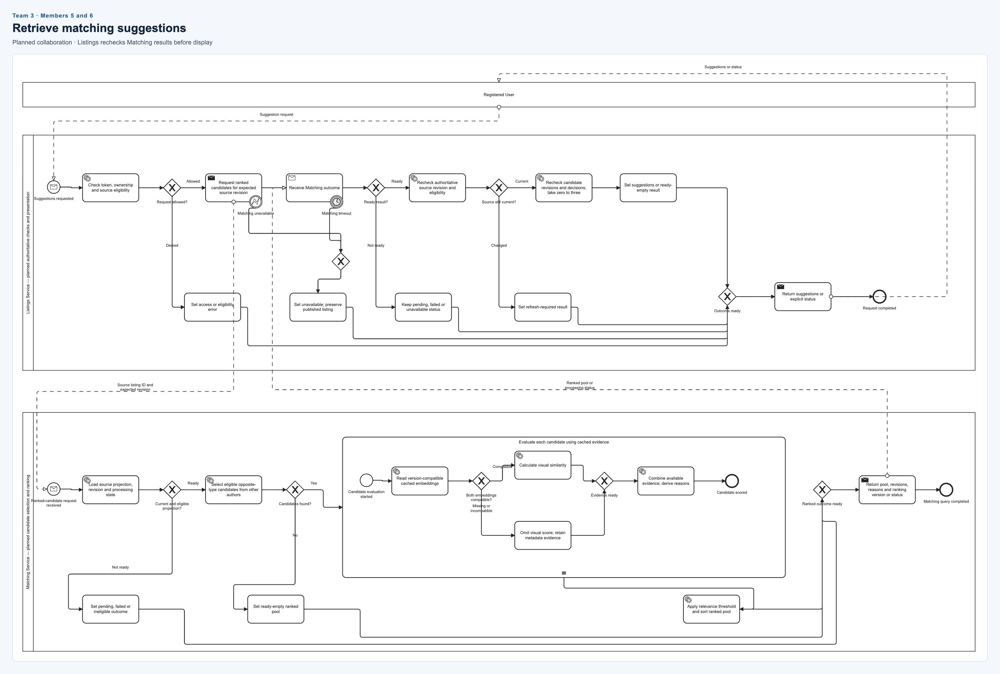

# Team 3 Matching suggestions

**Members:** 5 and 6. **Status:** planned collaboration between Listings and Matching;
the generated model and standalone AI experiments do not implement it.

[Editable BPMN](matching-suggestions.bpmn) · [SVG](matching-suggestions.svg) · [PNG](matching-suggestions.png)

| Member | Assigned responsibility |
| --- | --- |
| 5 | Explain Listings authorization, remote-call failures and final authoritative rechecks. |
| 6 | Explain Matching projection checks, candidate selection and repeated candidate scoring. |

## Flow to present

- Listings checks the caller, ownership and source eligibility before requesting ranked candidates.
- Send failure or timeout produces an unavailable outcome without undoing the published listing.
- Matching checks projection readiness/revision/eligibility and selects opposite-type candidates from other authors.
- An empty candidate pool is a ready-empty result, distinct from pending or failed processing.
- For each candidate, read compatible cached embeddings; calculate visual similarity when possible or omit that score. Combine available evidence and derive reasons, then threshold and sort the pool.
- Listings rechecks source and candidate revisions, reservations and decisions before returning zero to three results.

The expanded subprocess has a sequential multi-instance marker: its evaluation runs
once per candidate. Query-time scoring uses cached evidence, not fresh inference for
every candidate. Background embedding preparation and projection synchronization are
outside the diagram. Authorized internal service communication is a precondition;
the diagram does not define a new authentication protocol or route.

Separate service pools and cross-pool message flows express the SOA boundary.
Viewing suggestions creates no acceptance, recovery or credibility award.

## Design evidence

- [Existing matching sequence](../../../docs/diagrams/member-5/smartlost-matching-sequence.puml)
- [Matching design interpretation](../../../docs/diagrams/member-5/README.md)
- [Current Matching implementation status](../../../src/Services/Matching/README.md)

Actual names and contribution/commit links: **to be filled in by the pair**.

[All teams and editing instructions](../README.md)
