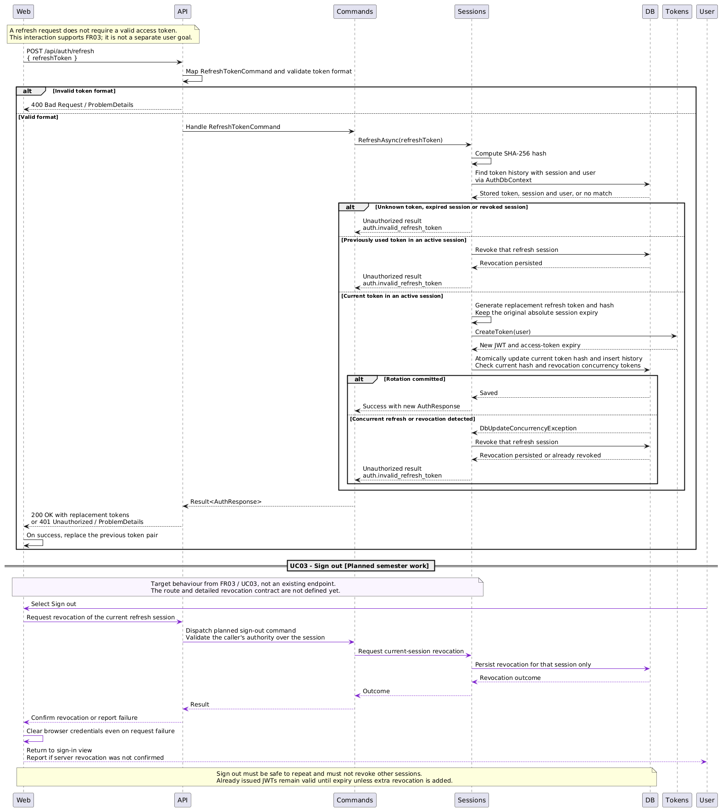
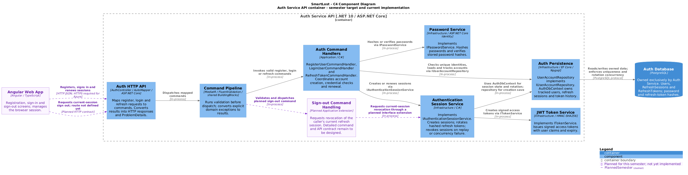

# Member 3: authentication

Two English diagrams for Problem 2, based on the
[requirements analysis](https://docs.google.com/document/d/1AYPYDg9ku5bWQCnwcyzXk9HWsxV3w5WU/edit) and the current
AuthService source. Purple elements/messages identify planned semester work.

## Diagram previews

PNG exports supplied by the user and moved from Desktop without changing their bytes.

### UML Sequence

Refresh-token rotation, replay/concurrency rejection and planned current-session sign out.

[Full-size PNG](images/smartlost-auth-sequence.png) · [Editable PlantUML](smartlost-auth-sequence.puml)

### C4 Component

Authentication API, command pipeline, password/session/token services and the Auth-owned database.

[Full-size PNG](images/smartlost-auth-components.png) · [Editable PlantUML](smartlost-auth-components.puml)

**Export note.** The supplied sequence PNG begins at refresh and omits the initial sign-in interaction. The complete UC02 sign-in flow is available in the sequence source.

## Files and editing

| Diagram | Text source | Purpose |
| --- | --- | --- |
| UML Sequence | [PlantUML](smartlost-auth-sequence.puml) | Sign in, session renewal, replay rejection and planned sign out |
| C4 Component, level 3 | [C4-PlantUML](smartlost-auth-components.puml) | Internal authentication components and their runtime dependencies |

Copy the complete contents of either file into the
[PlantUML online editor](https://www.plantuml.com/plantuml/uml/).
The C4 diagram uses `!include <C4/C4_Component>` from PlantUML's standard library.
No manual image layout or PNG export is required to edit these diagrams.

Notation references: [PlantUML sequence diagrams](https://plantuml.com/sequence-diagram),
[C4 component diagrams](https://c4model.com/diagrams/component) and
[C4-PlantUML](https://plantuml-stdlib.github.io/C4-PlantUML/).

## Scope and traceability

| Requirement / use case | Representation |
| --- | --- |
| FR01 / UC01 Register an account | C4 command handlers, password hashing, session creation and persistence. Registration returns tokens; no separate registration sequence is included. |
| FR02 / UC02 Sign in | Sequence: validation, normalized email lookup, password verification, session persistence and token response. |
| FR03 Maintain and end a session | Sequence: refresh rotation, unchanged absolute expiry, replay/concurrency revocation and planned sign out. |
| UC03 Sign out | Purple sequence section and planned C4 command handling. Current-session revocation and local credential clearing are semester requirements. |
| FR04 Access and ownership | Sign-out design must validate authority over the current session. Other services' ownership checks are outside this authentication view. |

The sequence contains three successive interactions. Renewal assumes a successful
sign-in; it does not occur after an unsuccessful login. The UI does not choose
the server's token-validation outcome. The sequence combines controller mapping
and the command pipeline into one API lifeline; C4 separates their responsibilities.

## Current implementation and remaining semester work

The existing API exposes only `POST /api/auth/register`, `POST /api/auth/login`
and `POST /api/auth/refresh`. These routes return token pairs; the controller does
not set an authentication cookie. Unknown email and incorrect password return
the same credential error. Invalid command data returns 400; an invalid,
expired or replayed well-formed refresh token returns 401.

Refresh-token history stores SHA-256 hashes. An old token from an active session
revokes that session. Concurrent rotation conflicts also revoke the session.
Rotation does not extend the absolute session expiry. Successful rotation is
committed before the new token pair is returned to the client.

Angular and explicit server sign out remain planned for this semester.
The sign-out API route, command and interface extension are deliberately labelled
as design work; no existing logout endpoint is implied. The target follows UC03:
revoke only the current session, make repeated sign out safe, and clear browser
credentials even if server revocation cannot be confirmed. A previously issued
access token remains subject to its expiry. Browser token storage is not selected
by these diagrams.

The C4 boundary expands **one Auth Service API container**, not the entire system.
Components inside it are logical responsibility groups in the same application
process. Auth Persistence groups the repository and EF Core context; the three
existing command handlers are grouped as one application component. Domain
entities and normalization remain internal implementation details.

C4 arrows show runtime calls through interfaces, not project-reference direction.
Application depends on its abstractions and Domain; Infrastructure implements
those abstractions, and API composes them. Auth alone owns the database. JWT
validation in other services, future campus identity, Azure resources and
business-service authorization belong in other views.

## Source correspondence

- [AuthController](../../../SmartLost.AuthService.Api/Controllers/AuthController.cs),
  [mapping](../../../SmartLost.AuthService.Api/Mapping/AuthMappingProfile.cs)
  and [API composition](../../../SmartLost.AuthService.Api/Program.cs)
- [Register handler](../../../SmartLost.AuthService.Application/Commands/Register/RegisterUserCommandHandler.cs),
  [login handler](../../../SmartLost.AuthService.Application/Commands/Login/LoginUserCommandHandler.cs)
  and [refresh handler](../../../SmartLost.AuthService.Application/Commands/Refresh/RefreshTokenCommandHandler.cs)
- [Command pipeline registration](../../../SmartLost.BuildingBlocks.Application/DependencyInjection.cs)
- [Session service](../../../SmartLost.AuthService.Infrastructure/Authentication/AuthenticationSessionService.cs),
  [password service](../../../SmartLost.AuthService.Infrastructure/Authentication/PasswordService.cs)
  and [JWT service](../../../SmartLost.AuthService.Infrastructure/Authentication/TokenService.cs)
- [User repository](../../../SmartLost.AuthService.Infrastructure/Persistence/UserAccountRepository.cs),
  [EF context](../../../SmartLost.AuthService.Infrastructure/Persistence/AuthDbContext.cs)
  and [session concurrency configuration](../../../SmartLost.AuthService.Infrastructure/Persistence/Configurations/RefreshSessionConfiguration.cs)

## Review scope

Requirements, routes, component names and persistence behaviour were inspected
against the document and repository source. User-provided PNG exports were imported
and visually inspected; current PlantUML sources were not re-rendered. Application tests, Docker and Azure deployment were not run for this
documentation change.
