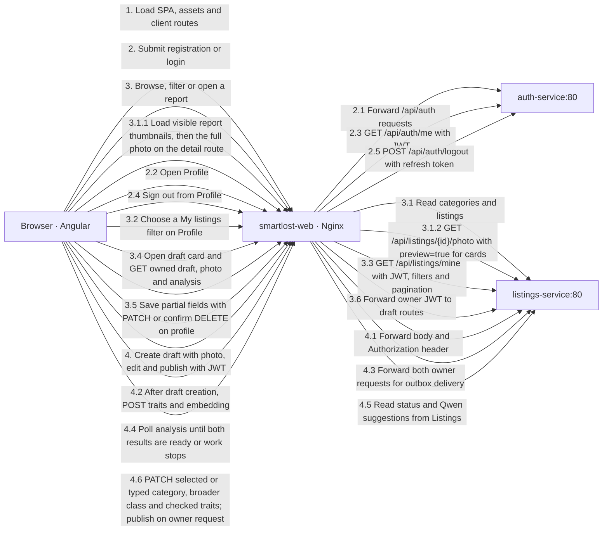

# Web communication

Nginx also routes the public Listings decision API. Matching and private photo routes remain internal. Each backend owns persistence and validation. Upstream HTTP errors reach Angular with their status, and the UI shows failures to the user. An unrecognized API route returns 404. Client-side page links resolve to the Angular entry point.
