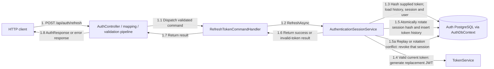

# Auth communication diagrams

These diagrams describe the current implementation. Numbered arrows show runtime
interactions, not compile-time project dependencies. Each numbered flow is independent.
Solid arrows are implemented; dashed arrows describe the required receiver contract,
whose implementation is absent. Auth owns every database table shown here.

## Registration and login

```mermaid
flowchart LR
    Client["HTTP client"]
    API["AuthController / AutoMapper"]
    Pipeline["MediatR validation pipeline"]
    Handler["RegisterUserCommandHandler or LoginUserCommandHandler"]
    Password["PasswordService"]
    Repository["UserAccountRepository"]
    Session["AuthenticationSessionService"]
    Tokens["TokenService"]
    Context["AuthDbContext + outbox mapper/writer"]
    DB[("Auth PostgreSQL: Users, RefreshSessions, RefreshTokens, OutboxMessages")]

    Client -->|"1. POST /api/auth/register or /api/auth/login"| API
    API -->|"1.1 Map request and dispatch command"| Pipeline
    Pipeline -->|"1.2 Invoke handler after validation"| Handler
    Handler -->|"1.3 Check uniqueness or load user"| Repository
    Repository -->|"1.3.1 Query Users through AuthDbContext"| DB
    Handler -->|"1.4 Hash password or verify credentials"| Password
    Handler -->|"1.5 Create session after successful checks"| Session
    Session -->|"1.5.1 Generate JWT"| Tokens
    Session -->|"1.5.2 Stage session and token history; save via repository"| Context
    Context -->|"1.5.3 Commit tracked rows and selected outbox events together"| DB
    Handler -->|"1.6 Return result through pipeline"| API
    API -->|"1.7 AuthResponse or error response"| Client
```

Registration also stages a new user through the repository. Its user, first session,
token history and `auth.user.created` message commit together. Login creates a session
but exports no session event. Failures short-circuit the successful path above.
The JWT is generated before saving but returned only after the save succeeds.

## Refresh and replay handling

Steps 1.4–1.5 are the valid-token path; 1.5a is the alternative replay/conflict path.
Unknown tokens and expired/revoked sessions return an invalid-token result without
rotation. Rotation preserves the session's original expiry. Refresh/session events
are local domain events and are not exported to the outbox.

## Durable profile notification and delivery

```mermaid
flowchart LR
    Operation["Auth operation: create user or change identity"]
    Context["AuthDbContext"]
    Mapper["AuthOutboxEventMapper / OutboxWriter"]
    DB[("Auth PostgreSQL: Users + OutboxMessages")]
    Worker["Separate finite AuthOutboxJob / OutboxProcessor"]
    Publisher["AuthOutboxHttpPublisher"]
    Receiver["Configured HTTP receiver: not implemented in this repository"]

    Operation -->|"1. Save tracked user changes"| Context
    Context -->|"1.1 Map selected domain events and stage messages"| Mapper
    Mapper -->|"1.2 Add OutboxMessage to the same context"| Context
    Context -->|"1.3 Commit user change and outbox row atomically"| DB
    Worker -->|"2. Read pending rows and claim with expiring lease"| DB
    DB -->|"2.1 Claimed message envelope"| Worker
    Worker -->|"2.2 PublishAsync"| Publisher
    Publisher -.->|"2.3 POST envelope with service key and Idempotency-Key"| Receiver
    Receiver -.->|"2.4 Contract: acknowledge with 2xx after durable processing"| Publisher
    Publisher -->|"2.5 Success or delivery failure"| Worker
    Worker -->|"2.6 Set ProcessedOn, or retry / dead-letter state"| DB
```

Flow 2 runs separately from flow 1. The API does not wait for receiver delivery.
Only `auth.user.created` and `auth.user.identity_changed` are exported, containing
`userId`, `userName` and `identityVersion`. Identity mutation exists in the domain;
there is no public profile-update endpoint currently.

Delivery can happen more than once. Receivers must durably deduplicate message IDs
and ignore older/equal identity versions before acknowledging. Leases limit competing
workers; failures use bounded retries and eventually dead-letter state. The worker
does not poll continuously: it runs a bounded number of batches and exits, including
when a batch acknowledges zero messages. Later retries require another invocation.
No cloud schedule or receiver is configured by the repository examples.

## Source references

- [Controller](SmartLost.AuthService.Api/Controllers/AuthController.cs) and [API composition](SmartLost.AuthService.Api/Program.cs)
- [Register](SmartLost.AuthService.Application/Commands/Register/RegisterUserCommandHandler.cs), [login](SmartLost.AuthService.Application/Commands/Login/LoginUserCommandHandler.cs) and [refresh](SmartLost.AuthService.Application/Commands/Refresh/RefreshTokenCommandHandler.cs) handlers
- [Session service](SmartLost.AuthService.Infrastructure/Authentication/AuthenticationSessionService.cs) and [AuthDbContext](SmartLost.AuthService.Infrastructure/Persistence/AuthDbContext.cs)
- [Event mapper](SmartLost.AuthService.Infrastructure/Outbox/AuthOutboxEventMapper.cs), [HTTP publisher](SmartLost.AuthService.Infrastructure/Outbox/AuthOutboxHttpPublisher.cs) and [shared processor](../../BuildingBlocks/SmartLost.BuildingBlocks.Infrastructure/Outbox/OutboxProcessor.cs)
- [Worker operation and receiver contract](SmartLost.AuthService.Worker/README.md)

## Review notes

- Initial diagrams checked against the API, handlers, session service, context and
  outbox implementation. Update affected flows with service changes; if communication
  is unchanged, record what changed and why these diagrams still apply here.
- 2026-10-22: Added a separate NMF structural-model project for Auth entities. It has no
  runtime references from the API, application, domain, infrastructure or worker layers, and
  does not add persistence, messages, workers or outgoing calls; all numbered flows remain unchanged.
