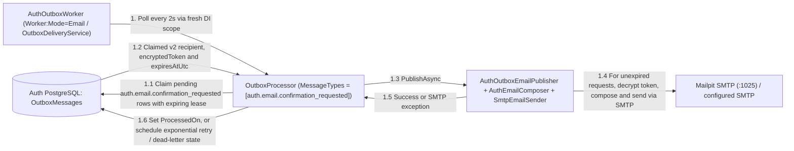
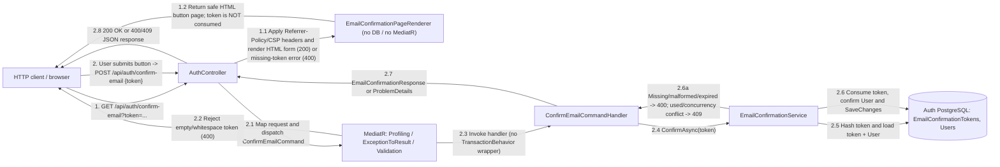
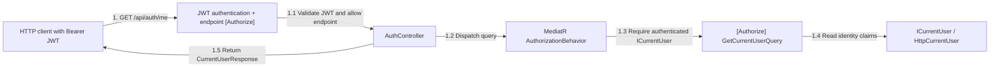
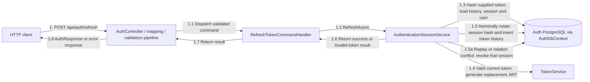
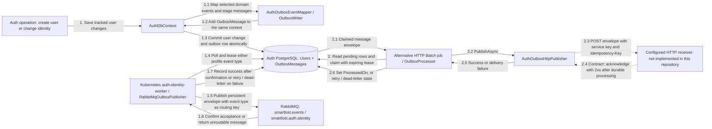
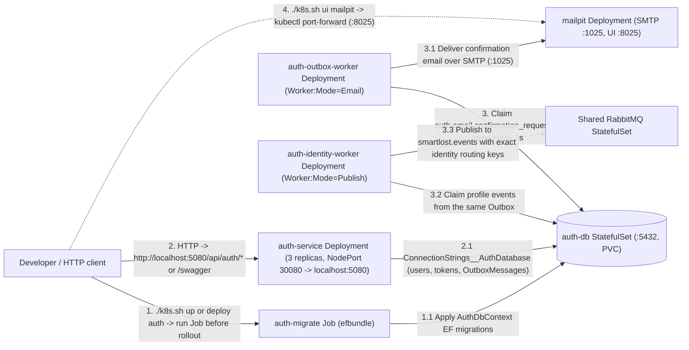

# Auth communication diagrams

These diagrams describe the current implementation. Numbered arrows show runtime
interactions, not compile-time project dependencies. Each numbered flow is independent.
Solid arrows are implemented; dashed arrows describe the required receiver contract,
whose implementation is absent. Auth owns every database table shown here.

## Registration and login

```mermaid
flowchart LR
    Client["HTTP client"]
    API["AuthController / AutoMapper"]
    Pipeline["MediatR: Profiling / ExceptionToResult / Authorization / Validation / Caching / Transaction"]
    Handler["RegisterUserCommandHandler or LoginUserCommandHandler"]
    Password["PasswordService"]
    Repository["UserAccountRepository"]
    Session["AuthenticationSessionService"]
    ConfirmSvc["EmailConfirmationService + IOutboxWriter"]
    Tokens["TokenService"]
    Context["AuthDbContext + outbox mapper/writer"]
    DB[("Auth PostgreSQL: Users, RefreshSessions, RefreshTokens, EmailConfirmationTokens, OutboxMessages")]

    Client -->|"1. POST /api/auth/register or /api/auth/login"| API
    API -->|"1.1 Map request and dispatch command"| Pipeline
    Pipeline -->|"1.2 After validation: begin AuthUnitOfWork transaction; invoke handler"| Handler
    Handler -->|"1.3 Check uniqueness or load user"| Repository
    Repository -->|"1.3.1 Query Users through AuthDbContext"| DB
    Handler -->|"1.4 Hash password or verify credentials"| Password
    Handler -->|"1.5 Create session after successful checks"| Session
    Session -->|"1.5.1 Generate JWT"| Tokens
    Session -->|"1.5.2 Stage session and token history without saving"| Context
    Handler -->|"1.5.3 Register only: stage EmailConfirmationToken hash and enqueue email Outbox request"| ConfirmSvc
    ConfirmSvc -->|"1.5.4 Enqueue auth.email.confirmation_requested into AuthDbContext"| Context
    Pipeline -->|"1.5.5 Success: SaveChanges via AuthUnitOfWork and commit; failure: rollback"| Context
    Context -->|"1.5.6 Commit user, session, tokens and both Outbox rows atomically; clear domain events"| DB
    Handler -->|"1.6 Return result through pipeline"| API
    API -->|"1.7 AuthResponse or error response"| Client
```

Registration stages a new user (`EmailConfirmed = false`), first session, refresh token history,
`EmailConfirmationToken` SHA-256 hash, `auth.user.created` outbox row, and `auth.email.confirmation_requested`
outbox row inside the active `TransactionBehavior` transaction without performing any SMTP I/O.
If the transaction fails or rolls back, no user, token or confirmation email outbox row persists.
Confirmation emails are dispatched asynchronously after commit with retry by the Auth Outbox Email worker.
Login creates a session without sending an email or exporting a session event. Failures short-circuit the successful path above.
The JWT is generated before saving but returned only after the pipeline commits.
RegisterUserCommand and LoginUserCommand implement ITransactionalCommand. Failure Results,
exceptions or cancellation roll back the transaction; rollback retains the entity events
and detaches discarded tracked work. RefreshTokenCommand is unmarked: its replay revocation
must persist even when the command returns an invalid-token failure.

## Post-commit confirmation email worker delivery

`OutboxProcessor` filters by `OutboxOptions.MessageTypes`: Email mode processes only
`auth.email.confirmation_requested` (`auth.user.created` and `auth.user.identity_changed` remain
available for the identity worker). Failed SMTP deliveries record `outbox.delivery_failed`
and retry with exponential backoff up to `MaximumAttempts` (default 8) before dead-lettering.

## Email confirmation

Link-preview/email scanners opening `GET /api/auth/confirm-email?token=...` only receive a safe
HTML confirmation page (`Referrer-Policy: no-referrer`, `X-Frame-Options: DENY`, `Content-Security-Policy`)
whose button triggers `POST /api/auth/confirm-email` via `fetch`. Confirmation links carry the raw
32-byte Base64Url token, while EmailConfirmationTokens stores its SHA-256 hex digest with `ExpiresAtUtc`
and single-use `UsedAtUtc`. Confirming marks `EmailConfirmationToken.UsedAtUtc` and
`UserAccount.EmailConfirmed` / `EmailConfirmedAtUtc` atomically via `AuthDbContext.SaveChangesAsync`
(no outbox event). Concurrent consumption maps `DbUpdateConcurrencyException` to `409 Conflict`.
(Current scope has no email-change endpoint; any future address-change flow must invalidate prior
unconsumed tokens or bind tokens to the target email.)

## Current user identity

The HTTP attribute rejects unauthenticated requests before the action executes. The Application
attribute separately protects direct MediatR dispatches; register, login and refresh requests
have no Application authorization attribute and remain public.

## Refresh and replay handling

Steps 1.4–1.5 are the valid-token path; 1.5a is the alternative replay/conflict path.
Unknown tokens and expired/revoked sessions return an invalid-token result without
rotation. Rotation preserves the session's original expiry. Refresh/session events
are local domain events and are not exported to the outbox.

## Durable profile notification and delivery

The API returns after commit. Kubernetes uses steps 1.4–1.7. Flow 2 is an alternative
HTTP transport for the same rows. Run one identity transport per Auth database.
Only `auth.user.created` and `auth.user.identity_changed` are exported, containing
`userId`, `userName` and `identityVersion`. Identity mutation exists in the domain;
there is no public profile-update endpoint currently.

Delivery can happen more than once. Receivers must durably deduplicate message IDs
and ignore older/equal identity versions before acknowledging. Leases limit competing
workers; failures use bounded retries and eventually dead-letter state. The HTTP Batch worker is finite: it runs a bounded number of batches and exits, including
when a batch acknowledges zero messages. Later retries require another invocation.
No cloud schedule or receiver is configured by the repository examples.

## Local Kubernetes Auth and Mailpit runtime

In the local Kubernetes Kind overlay (`deploy/kubernetes/overlays/local`), `auth-service` mounts
the `auth-settings` ConfigMap (`EmailConfirmation:ConfirmationBaseUrl` pointing to
`http://localhost:5080/api/auth/confirm-email`) at `/app/appsettings.json` without connecting to
SMTP directly. `auth-outbox-worker` runs as a dedicated read-only rootfs non-root Deployment
mounting `auth-settings` (`Worker:Mode=Email`, `Smtp:Host=mailpit`, `OutboxDelivery:PollInterval=00:00:02`)
at `/app/outboxsettings.json` and `ConnectionStrings__AuthDatabase` from the `auth-credentials`
Secret. Mailpit runs in-memory (`axllent/mailpit:v1.34.0`) inside the cluster and is reachable
on `http://localhost:8025` through `./k8s.sh ui mailpit`.

## Source references

- [Controller](SmartLost.AuthService.Api/Controllers/AuthController.cs), [confirmation page renderer](SmartLost.AuthService.Api/Pages/EmailConfirmationPageRenderer.cs) and [API composition](SmartLost.AuthService.Api/Program.cs)
- [Register](SmartLost.AuthService.Application/Commands/Register/RegisterUserCommandHandler.cs), [confirm email](SmartLost.AuthService.Application/Commands/ConfirmEmail/ConfirmEmailCommandHandler.cs), [login](SmartLost.AuthService.Application/Commands/Login/LoginUserCommandHandler.cs) and [refresh](SmartLost.AuthService.Application/Commands/Refresh/RefreshTokenCommandHandler.cs) handlers
- [Current-user query](SmartLost.AuthService.Application/Queries/GetCurrentUser/GetCurrentUserQuery.cs), [handler](SmartLost.AuthService.Application/Queries/GetCurrentUser/GetCurrentUserQueryHandler.cs) and [shared authorization behavior](../../BuildingBlocks/SmartLost.BuildingBlocks.Application/Behaviors/AuthorizationBehavior.cs)
- [Session service](SmartLost.AuthService.Infrastructure/Authentication/AuthenticationSessionService.cs), [email confirmation service](SmartLost.AuthService.Infrastructure/Authentication/EmailConfirmationService.cs) and [AuthDbContext](SmartLost.AuthService.Infrastructure/Persistence/AuthDbContext.cs)
- [Shared SMTP email sender](../../BuildingBlocks/SmartLost.BuildingBlocks.Infrastructure/Emails/SmtpEmailSender.cs) and [Outbox email publisher](SmartLost.AuthService.Infrastructure/Outbox/AuthOutboxEmailPublisher.cs)
- [Event mapper](SmartLost.AuthService.Infrastructure/Outbox/AuthOutboxEventMapper.cs), [HTTP publisher](SmartLost.AuthService.Infrastructure/Outbox/AuthOutboxHttpPublisher.cs) and [shared processor](../../BuildingBlocks/SmartLost.BuildingBlocks.Infrastructure/Outbox/OutboxProcessor.cs)
- [Worker host](SmartLost.AuthService.Worker/Program.cs) and [worker operation and receiver contract](SmartLost.AuthService.Worker/README.md)
- [Auth Kubernetes manifests](../../../deploy/kubernetes/base/auth), [Mailpit manifests](../../../deploy/kubernetes/base/mailpit) and [Auth migration Job](../../../deploy/kubernetes/migrations/auth-job.yaml)

## Review notes

- 2026-11-20: Moved confirmation email dispatch from synchronous in-transaction SMTP calls inside `RegisterUserCommandHandler` into the shared `OutboxMessages` table (`auth.email.confirmation_requested`), delivered after commit with retry by `SmartLost.AuthService.Worker` (`Worker:Mode=Email`, filtered via `OutboxOptions.MessageTypes` so `Batch` profile delivery remains isolated). Added Compose service `auth-email-worker` and Kubernetes Deployment `auth-outbox-worker`. Changed `GET /api/auth/confirm-email` to render an interactive HTML confirmation page (`EmailConfirmationPageRenderer` with `Referrer-Policy`/`CSP`/`X-Frame-Options` headers) whose button triggers `POST /api/auth/confirm-email`, preventing link-scanner GET requests from consuming tokens. `/api/auth/me` and refresh rotation are unchanged.

- 2026-11-18: Added Auth email confirmation (`GET`/`POST /api/auth/confirm-email`), hashed single-use `EmailConfirmationTokens` table (`20261118121203_AddEmailConfirmation` migration), `Mailpit` SMTP integration in root `docker-compose.yml` (`1025`/`8025`), shared BuildingBlocks `IEmailSender` / `SmtpEmailSender`, pinned Auth Dockerfiles (`migrations` target + `USER app`), and local Kubernetes manifests + `./k8s.sh` targets (`auth`, `mailpit`, NodePort `30080` -> `localhost:5080`). Updated registration, email confirmation and local Kubernetes flows; `/api/auth/me`, refresh rotation and finite HTTP worker outbox flows remain unchanged.

- 2026-11-17: Upgraded API AutoMapper from 16.2.0 to 16.3.0 and refreshed API/unit/integration
  dependency locks to fix GHSA-6vhm-j9h7-f9gh and GHSA-gpwp-5797-mjff. Existing request-to-command
  maps, API routes, JWT claims and database/worker communications are unchanged; no arrow changes.

- 2026-11-17: Reviewed shared continuous Outbox host and opt-in RabbitMQ transport. Auth retains its finite HTTP delivery worker; no RabbitMQ registration or new outgoing/incoming arrow is introduced.

- 2026-11-17: Reviewed shared Outbox inspection reader/host additions. Auth does not opt
  into inspection; its existing finite HTTP-delivery worker, claim/retry behavior and
  numbered API/database/message flows are unchanged. The new hosting-abstractions
  dependency adds no Auth process or network interaction.

- 2026-11-10: Extracted transaction lifecycle into shared EfUnitOfWork/EfTransaction and event
  staging into OutboxDbContext/DomainEventOutboxCoordinator. AuthDbContext now owns only its
  model; AuthUnitOfWork preserves repository error mapping. Existing numbered
  save/commit/rollback, refresh and worker arrows retain the same behavior.

- 2026-11-09: Root Compose now groups all three APIs and their databases. Listings containers
  were moved from the standalone project while reusing the existing volume as external; fresh
  setups use a managed volume. Only container grouping, network placement and configuration
  paths change. HTTP routes, database ownership, CQRS/worker flows and outgoing service calls
  are unchanged.

- 2026-11-09: enabled TransactionBehavior for register/login and added scoped AuthUnitOfWork.
  Flow 1 now begins a transaction after validation, stages session/token changes, and saves
  user/session/token/Outbox rows once before the final commit. Events clear after commit;
  failures roll back and discard tracked state. Refresh, current-user reads, worker delivery
  and cross-service boundaries are unchanged. SQLite and PostgreSQL tests cover the change.

- 2026-11-09: moved GetCurrentUserQuery and its authorization attribute into its own
  file, separate from the handler. Types, namespaces, authorization checks and MediatR
  dispatch are unchanged; all numbered HTTP, persistence and worker arrows still apply.

- 2026-11-08: Enabled shared profiling and the attribute-driven cache wrapper alongside
  authorization. No Auth request carries a cache attribute, so identity/token responses remain
  per-request. Registration, JWT, database and worker/Outbox arrows are unchanged; profiling
  adds operation metadata logging around MediatR without request payloads.

- 2026-11-08: integrated main's authorization/profiling with Listings caching in the shared
  registration. Auth still enables only authorization; registration/login/refresh remain
  public and /me retains both HTTP and Application protection. Its API, persistence and
  Outbox arrows are unchanged. Existing patched Auth images are retained.

- 2026-11-08: reviewed the shared Listings contracts project and CI inventory/coverage
  handling. Auth does not reference it; API, database, worker and Outbox arrows remain
  unchanged. A contract-only library introduces no runtime communication.

- 2026-11-08: reviewed the shared cache expiration fix: stale lookups no longer remove
  a concurrent refresh by key. Auth does not enable query caching, so its numbered API,
  persistence and Outbox arrows and failure/retry paths remain unchanged.

- 2026-11-06: API/worker Dockerfiles now patch and version-check the inherited Ubuntu
  APT packages for USN-8996-1 using HTTPS sources before non-root execution. This is a
  build-time OS package update; numbered HTTP, persistence, Outbox and receiver arrows,
  runtime settings and failure/retry behavior are unchanged.

- 2026-11-04: reviewed shared query-cache additions. Auth still calls AddBuildingBlocksApplication without useCaching and does not register IQueryCache. Its credential/session commands and numbered runtime/database/Outbox arrows are unchanged.

- Initial diagrams checked against the API, handlers, session service, context and
  outbox implementation. Update affected flows with service changes; if communication
  is unchanged, record what changed and why these diagrams still apply here.
- 2026-10-22: Added a separate NMF structural-model project for Auth entities. It has no
  runtime references from the API, application, domain, infrastructure or worker layers, and
  does not add persistence, messages, workers or outgoing calls; all numbered flows remain unchanged.
- 2026-11-05: root `docker-compose.yml` gained the separate `matching-db` (host port 5433,
  volume `matching-db-data`) and `matching-service` (host port 8081) services. Auth services,
  ports, settings, database and flows are unchanged; Auth has no connection to Matching.
- 2026-11-05: the API and worker Dockerfiles now run `apt-get upgrade` in the runtime stage,
  so the image includes Ubuntu security fixes newer than `aspnet:10.0` (CVE-2026-109518 in
  `apt` failed the CI Trivy image gate). This is a container build change only; Auth code,
  settings, ports and all flows are unchanged.

- 2026-11-08: reviewed shared opt-in profiling extraction into BuildingBlocks. Auth does not enable profiling, so JWT, validation, persistence, Outbox delivery and all numbered communication arrows are unchanged.
- 2026-11-08: removed the previous cross-cutting prototype and its persistence/inspection route.
  Added the opt-in attribute-based AuthorizationBehavior and `/api/auth/me`. Endpoint and
  Application attributes admit the same bearer-authenticated caller; this adds no persistence,
  outgoing call, worker or message interaction.
