# Listings communication diagrams

Domain implements in-process business behavior. Infrastructure implements EF persistence
and explicit migration tooling. API/Application implement three public read queries
through MediatR. Authenticated mutations, blob and inter-service calls remain unimplemented.
Modeling is a separate NMF representation; runtime projects do not reference it.

## Current local container flow

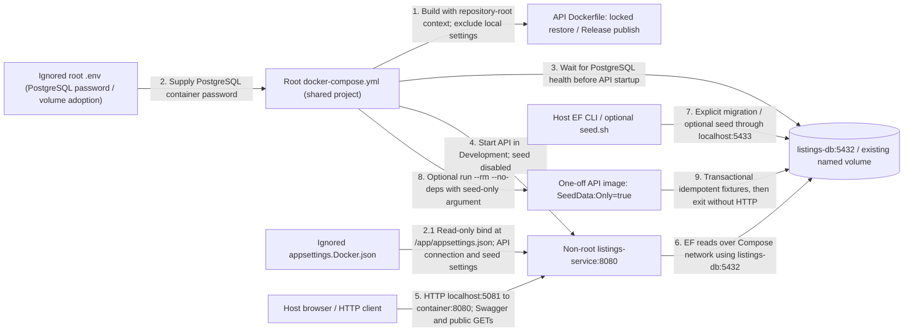

The root Compose file groups Auth, Listings and Matching and their own databases.
Listings retains its database/volume; the existing local volume is adopted as external,
while fresh setups create a managed volume. `up listings-db` starts only its database;
host port 5081 is bound to loopback. A local dotnet
API and the container cannot bind that port simultaneously. No Auth/Matching network
calls are introduced. API/Compose startup never applies migrations; database health is
not schema readiness. Database read errors follow the existing HTTP 500 path, without a
new query retry policy. Both services use `restart: unless-stopped` for process exits;
one-off seed failures exit nonzero for manual correction/retry. Cache remains per API
process and is cleared on API restart. Stop/down preserve database data unless volume
removal is explicitly requested; adopted external volumes survive even `down --volumes`.
Cloud deployment remains inactive.

## Local Kubernetes alternative

The checked-in [local Kubernetes runbook](../../../deploy/kubernetes/README.md) covers
Listings only. Root Compose remains an alternative; its PostgreSQL volume is not adopted.

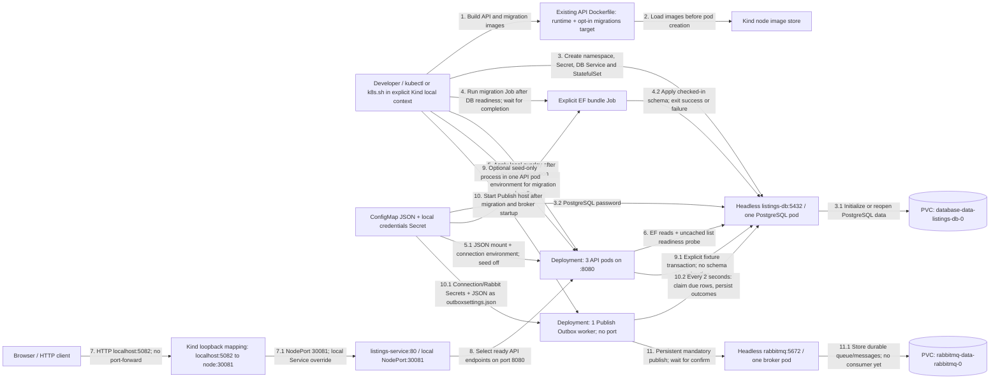

Migration Job failures exit nonzero and require explicit correction/recreation (no
automatic retry). API/database process crashes are restarted by Kubernetes; pod deletion
is reconciled by their controllers. The API readiness query fails when PostgreSQL/schema
is unavailable, removing that pod from normal Service traffic; TCP liveness does not
restart the API merely because the database is down. Application query retry behavior
is unchanged. The singleton database is unavailable during pod replacement and is not HA.
The PVC survives database pod replacement/StatefulSet deletion, but namespace or Kind
cluster deletion destroys this local data. Category cache remains per process; restart
API pods or wait for TTL after optional seeding if an empty category result was cached.
The Publish worker adds an outgoing AMQP connection and retries failed deliveries through
the shared processor. No HTTP route or cloud workflow is added. Worker readiness indicates
a running host, not successful DB/broker delivery. Startup does not migrate or seed
automatically. Swagger is Development-only.
The base API Service remains ClusterIP; the local overlay alone adds NodePort 30081.
The Kind node publishes only Listings on loopback port 5082. Auth, Matching and databases
have no additional host mappings. Changing Kind mappings requires node recreation and
database backup/restore; applying the Service patch alone does not publish a host port.

## Current NMF modeling flow

Solid numbered arrows describe local modeling tools and tests, not a running service.

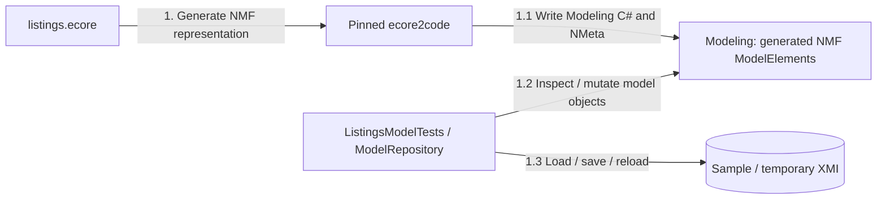

NMF maintains structural opposites, containment and notifications for model/XMI work.
Domain/Entities and Domain/Enums are maintained manually. There is no Domain generation
or runtime conversion of NMF instances. DomainStructureTests reads Ecore only to check
that the manually maintained Domain fields, enums/defaults and encapsulation remain
consistent with the modeled structure; it does not generate files.

## Current public HTTP read and category-cache flow

```mermaid
flowchart LR
    Client["HTTP client"]
    API["Categories / Listings controller"]
    Validation["MediatR: Profiling + ExceptionToResult + Authorization + Validation"]
    Aspect["CachingBehavior: inspect CacheableQueryAttribute"]
    Cache["Singleton IQueryCache / MemoryQueryCache"]
    Handler["Query handler"]
    Port["IListingsReadStore / EF projection"]
    DB[("Listings PostgreSQL")]
    Result["Typed Result / HTTP adapter"]
    Client -->|"1. GET categories, filtered listings or details"| API
    API -->|"2. Bind input; send query and cancellation"| Validation
    Validation -->|"3. Valid query"| Aspect
    Validation -->|"3.1 Invalid query: HTTP 400"| Result
    Aspect -->|"4. Categories: typed/parameter key, TTL 300 seconds"| Cache
    Aspect -->|"4.1 Unmarked list/detail: call next directly"| Handler
    Cache -->|"5. Unexpired hit: immutable successful snapshot"| Result
    Cache -->|"5.1 Miss: await stripe, recheck, invoke next"| Handler
    Handler -->|"6. Read DTOs / filtered page / Open detail"| Port
    Port -->|"7. SELECT AsNoTracking; filter/sort/project/paginate"| DB
    DB -->|"8. Selected values"| Handler
    Handler -->|"9. Categories: freeze DTO list; store only non-cancelled success"| Cache
    Handler -->|"9.1 Return Result; missing/hidden detail maps to 404"| Result
    Result -->|"10. HTTP 200 DTOs or ProblemDetails"| Client
```

Model-binding failures return HTTP 400 before MediatR. Validators run before cache
lookups, including hits. Only GetCategoriesQuery is annotated; unmarked listing/detail
queries always query current Open-only data. Missing, Draft and Closed details remain
indistinguishable (404). Read DTOs exclude private BlobKey and mutable Domain entities.

MemoryQueryCache uses absolute TTL, process-local storage, a 1024-entry capacity and
32 bounded miss-lock stripes. Same-key concurrent misses populate once; hits skip the
handler/read store. Failure Results, thrown exceptions and cancellation are not stored.
Cancelled waiters do not cancel another request's population. GetCategoriesQueryHandler
returns a read-only snapshot of immutable CategoryDto records. Direct catalog changes
can remain stale until expiry; mutation invalidation is not implemented in this phase.

Read requests do not write, start an application transaction or call Auth/Matching/Blob
Storage. Cancellation reaches EF on misses; unexpected exceptions use the shared generic
HTTP 500 handler. Debug cache hit/miss logs identify the query type without parameter
values. See [cache implementation and AOP explanation](../../../docs/QUERY_CACHING.md).

## Current optional development seed flow

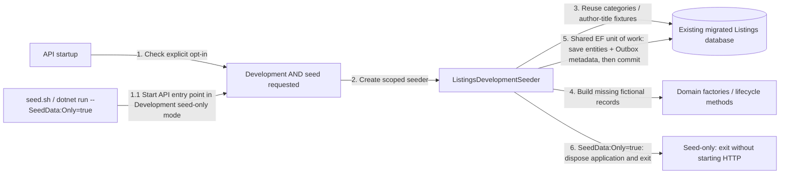

The default is no seed. Outside Development, SeedData:Enabled is ignored. Seeding does not
create/migrate a database or upload an image; one fixture carries photo metadata only.
The separate SeedData:Only flag requests seeding even when SeedData:Enabled is false;
it is rejected outside Development before any seed writes. seed.sh uses the existing
API connection settings and finishes without opening an HTTP listener. Startup-enabled
seeding instead continues into the regular read API. Neither mode invalidates the cache
of a separately running API process; its categories can stay stale until TTL/restart.
Repeated sequential runs preserve existing fixture records. Read endpoints expose the
four Open samples; Draft/Withdrawn fixtures remain hidden. Canonical local connection
settings now live beside the API; Infrastructure links that same file for EF CLI.
Newly created published fixtures generate notification rows; unchanged seed reruns do
not recreate historical events. Outbox event cleanup occurs after the seed transaction commits.

## Current Outbox persistence, inspection and RabbitMQ delivery

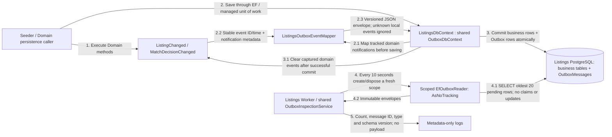

Implicit saves use EF's transaction; explicit event saves require the shared unit of work.
Unmanaged/ambient boundaries are rejected before staging. Failure rolls back business
and Outbox changes; rollback retains domain events on entity references and discards
tracked state. Inspection filters out processed/dead-lettered rows but may show leased
or deferred-retry messages. It never changes attempts, leases, processing timestamps or
errors. Repeated polls can log the same oldest batch. Inspect is the local default;
Publish is selected in Kubernetes and follows the separate flow below. Existing payloads
are not complete Matching snapshots. AddListingsOutbox does not backfill earlier changes.

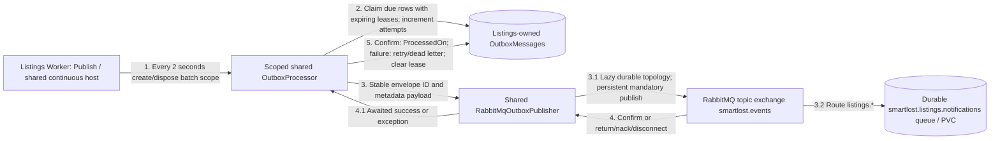

`ProcessedOn` means broker acceptance, not consumer application. There is no Matching
consumer. Failures retry with backoff, up to 8 attempts, then remain dead-lettered in
PostgreSQL; automatic replay is not implemented. Expired claims can be recovered. A crash
after confirm before DB update can duplicate an ID. Future consumers need deduplication
and stale-sequence handling; retries/parallel workers do not guarantee aggregate ordering.
One classic broker/queue with a PVC is persistent but not highly available.

## Current development API documentation flow

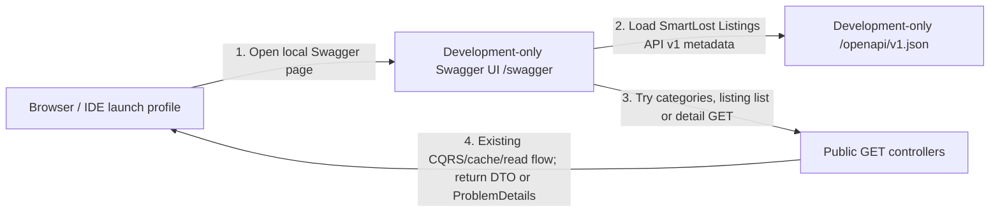

Swagger UI and OpenAPI are not registered outside Development. No JWT authorization or
public seed endpoint is introduced; the existing three public read routes are unchanged.

## Current Domain behavior

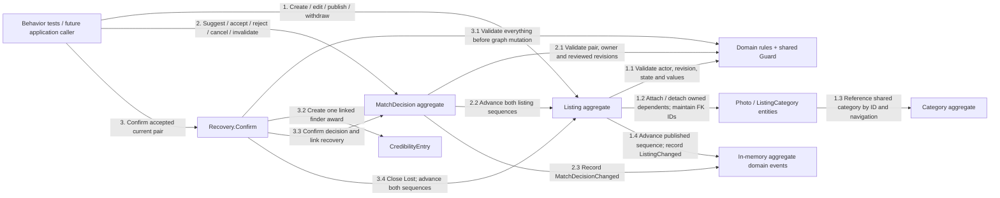

Guard failures throw `DomainException`; validation occurs before existing graph changes.
An already confirmed decision rejects another confirmation. Public setters and collection
mutation cannot bypass behavior. The caller supplies actor identity; HTTP authentication
is not implemented here. Cross-root transaction/concurrency, global reservations,
consumed Found eligibility, automatic invalidation and durable retries remain pending.
When tracked entities are saved, selected events are staged in the service-owned Outbox;
no event is published to another service.

## Current Infrastructure and explicit migration flows

Solid numbered arrows are implemented calls, exercised by CLI commands and tests.
The API uses this same context for read queries; CLI commands remain independent of HTTP startup.

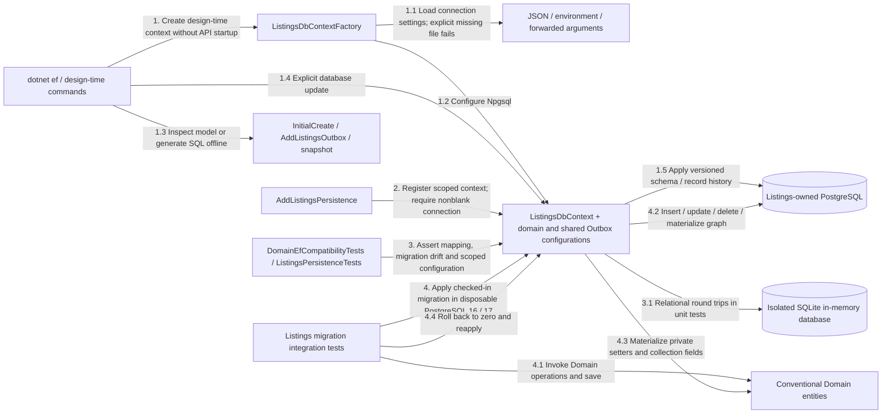

The test/CLI databases are explicitly chosen: integration containers use isolated databases
and random host ports, while the optional database-only Compose uses localhost:5433.
The root Auth database/Compose stack is unchanged. Offline model/script commands do not
connect to a database. DI registration does not open connections or run migrations;
API and Compose startup do not apply them automatically. Only explicit Development seed
opt-in writes fixture data during API startup; it does not migrate the schema.

Listing Revision/ChangeSequence and decision State protect optimistic writes. Stale saves
throw DbUpdateConcurrencyException; unique/FK violations throw DbUpdateException. No
application retry orchestration is wired. Physical FKs stay inside Listings; Auth user IDs
are logical references. Photo/assignment deletion cascades; historical/shared references
restrict deletion. DomainEvents are ignored as mapped columns; selected notifications
are staged in Outbox and cleared after commit. Inspect mode does not deliver them;
Publish sends metadata notifications to RabbitMQ.
See [Infrastructure commands/configuration](SmartLost.ListingsService.Infrastructure/README.md)
and the [verification report](../../../docs/LISTINGS_EF_COMPATIBILITY.md).

## Planned service integrations — not implemented

All dashed arrows describe design intent. Exact contracts and retry behavior remain
application/infrastructure work.

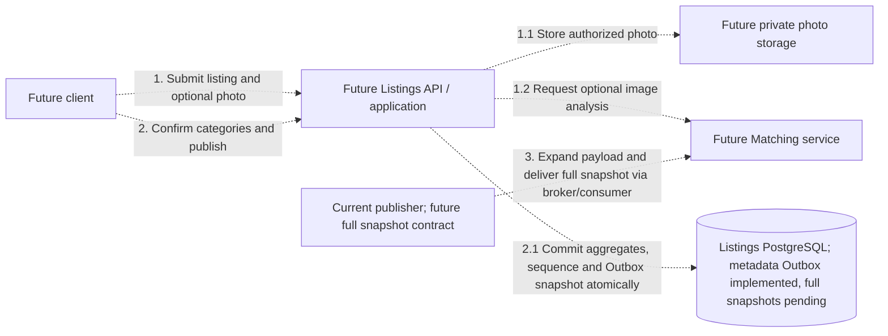

Only Listings will access its database/photo storage. Auth identities and Matching
results use logical IDs, without cross-service physical FKs. Auth Outbox reception,
snapshot delivery and inference calls are not implemented in Listings. The current worker
publishes metadata to RabbitMQ; full snapshot production/consumption remains planned.

## Source references

- [Service state](README.md), [Domain behavior](SmartLost.ListingsService.Domain/README.md)
- [NMF modeling](SmartLost.ListingsService.Modeling/README.md), [manual Domain entities](SmartLost.ListingsService.Domain/Entities/)
- [Model, Domain and persistence tests](../../../tests/Listings/SmartLost.ListingsService.UnitTests/README.md)
- [Proposed publication activity](../../../docs/diagrams/member-4/smartlost-publication-activity.puml)

## Review notes

- 2026-11-20: Reviewed shared BuildingBlocks `OutboxOptions.MessageTypes` filtering and root
  Compose / Kubernetes additions (`auth-email-worker` in Compose, `auth-outbox-worker` in K8s).
  Listings leaves `OutboxOptions.MessageTypes` null so its worker behavior, database ownership,
  RabbitMQ topology, API routes and `./k8s.sh` Listings flows remain unchanged.

- 2026-11-18: Reviewed shared BuildingBlocks `IEmailSender` / `SmtpEmailSender`, root Compose
  `mailpit` container, and local Kubernetes Auth/Mailpit manifests plus `./k8s.sh` targets.
  Listings does not register `IEmailSender`, does not communicate with Mailpit or Auth at
  runtime, and preserves its API/database/RabbitMQ/worker arrows. `./k8s.sh deploy` with no
  argument now defaults to `all`, while `./k8s.sh deploy listings` and `listings-nodeport`
  (`30081` -> `5082`) preserve existing Listings cluster behavior.

- 2026-11-17: Split Program construction and execution so seed-only tests can own the
  application's lifetime without WebApplicationFactory's deferred-start/disposal race.
  HTTP tests still execute Main. Current seed, persistence and HTTP arrows are unchanged:
  Production rejects SeedData:Only before writes; Development seed-only exits without HTTP.

- 2026-11-17: Added the root local k8s.sh helper around the existing build/load, migration,
  infrastructure, rollout, logs and stop operations. Updated the operator label; runtime
  API/DB/AMQP arrows and contracts are unchanged. Migration generation remains local;
  the helper refuses to replace active Jobs and does not activate CI/cloud deployment.

- 2026-11-17: RabbitMQ Publish mode uses shared continuous delivery and a separate shared
  transport. Added confirmed publishing/retry/queue arrows; reviewed every service diagram.
  No Matching consumer, new HTTP endpoint or schema migration was added by this step.

- 2026-11-17: Added AddListingsOutbox, shared event-save integration and Listings' continuous
  read-only inspection host/Deployment. Updated seed, Kubernetes and persistence arrows;
  added the current Outbox diagram. No broker, publisher, delivery claims or new HTTP
  mutation endpoint is introduced. Auth/Matching diagrams were reviewed for shared changes.

- 2026-11-17: Replaced Listings' temporary Kubernetes port-forward access with a local-only
  NodePort/Kind mapping on 5082. Updated arrows 7-8; the base Service stays ClusterIP.
  No other service is exposed, and the API/query/seed/database ownership flows are unchanged.

- 2026-11-17: Added the local Kubernetes hosting alternative, ConfigMap/Secret inputs,
  separate migration target/Job, real-read readiness, explicit seed and PVC/recovery paths
  above. Existing HTTP/CQRS contracts, database ownership and planned integration arrows
  remain unchanged; no RabbitMQ or Outbox is implemented. Both runtime targets now pin
  ASP.NET 10.0.15 after image scanning identified three vulnerabilities in 10.0.14;
  application routes and communication are unchanged by the runtime patch.

- 2026-11-10: Reviewed shared EF transaction/Outbox extraction. Listings keeps a normal
  DbContext and its read-only queries; it does not opt into the Outbox base or transaction
  behavior. Numbered API/cache/EF/seed/container flows and database ownership are unchanged.

- 2026-11-09: Root Compose now groups all three APIs and their databases. Listings containers
  were moved from the standalone project while reusing the existing volume as external; fresh
  setups use a managed volume. Only container grouping, network placement and configuration
  paths change. HTTP routes, database ownership, CQRS/worker flows and outgoing service calls
  are unchanged.

- 2026-11-09: switched API configuration to a read-only appsettings.Docker.json bind,
  matching Auth/Matching. Flow 2 now supplies only the PostgreSQL password and flow 2.1
  supplies API settings from JSON. Database credentials must match between files; the
  existing database volume is unchanged. Runtime routes, CQRS/cache, migration and seed
  flows are unchanged. Docker settings are excluded from build/publish output.

- 2026-11-08: Enabled shared profiling and the authorization wrapper alongside category caching.
  Current public reads have no authorization attribute, so their routes and database/cache
  arrows are unchanged. Profiling surrounds every MediatR operation; category cache hits still
  follow authorization/validation checks.

- 2026-11-08: integrated main's Matching runtime and Auth authorization without losing
  the Listings cache path. Shared registration now supports profiling, authorization and
  caching together; Listings still enables only caching. Matching's separate host database
  port is now 5434, leaving Listings on 5433. Current HTTP/cache/EF/seed arrows are unchanged;
  there are still no real Listings-to-Matching calls.

- 2026-11-08: runtime entities, DTOs, filters and JSON enum conversion now use
  `SmartLost.Contracts.Listings.ListingType` instead of a local Domain enum. Stable
  Lost/Found values, database mapping and HTTP representation are unchanged. Existing
  HTTP/CQRS/cache/EF arrows still apply; no outgoing service interaction is added.
  NMF tests compare their independent enum to the shared contract.

- 2026-11-08: shared cache expiration lookups no longer remove by key after reading an
  old entry. Concurrent expired category requests recheck under the existing stripe
  and reuse a refresh already completed by another caller. The current cache flow,
  routes, database ownership and failure/cancellation arrows remain unchanged; no new
  service calls or retries were added.

- 2026-11-06: the API runtime Dockerfile now patches/version-checks inherited Ubuntu
  APT packages for USN-8996-1 using HTTPS sources and pins the final ASP.NET runtime to
  patched version 10.0.14. The existing build arrow includes
  this OS maintenance; runtime ports/settings, CQRS/cache/EF arrows, seeding and data
  ownership are unchanged. No new runtime communication or retries were introduced.

- 2026-11-04: added a non-root, digest-pinned API Dockerfile and optional Compose override
  beside the existing database-only stack. New arrows cover image build, runtime settings,
  health ordering, loopback HTTP mapping, internal database DNS and image-based seeding.
  CQRS/cache/data-ownership arrows are unchanged; only the API host placement changes.

- 2026-11-04: enabled attribute-driven cache only on GetCategoriesQuery, with optional
  shared Application behavior and process-local Infrastructure backend. The public flow
  now shows hit/miss branches, expiration, cancellation/failure behavior and unchanged
  uncached list/detail reads. New tests count actual EF SELECTs and control the clock.

- 2026-11-04: renamed the four Application read contracts to CategoryDto, PhotoDto,
  ListingSummaryDto and ListingDetailsDto and moved them to Application/Dtos. Query,
  handler, read-store and controller references use the same renamed types. Numbered
  communication arrows are unchanged because routing, validation, database reads and
  JSON properties are unchanged; OpenAPI schema type names now use the Dto suffix.

- 2026-11-04: moved runtime behavior from Modeling partials into conventional Domain
  entities with local domain events and read-only collections. The Domain generator was
  subsequently removed: declarations and behavior are now maintained together in each
  entity file; enums are maintained in Domain/Enums. NMF output generation stays separate.
  Public read HTTP/CQRS flow and opt-in Development seeding were subsequently added,
  with SQLite TestServer and PostgreSQL HTTP checks. Category query caching was added
  subsequently as documented above; mutation endpoints/inter-service transport remain absent.
  Replaced NMF EF probes with seven-type Domain mapping checks. A subsequent persistence
  setup adopts those mappings in Infrastructure with a design-time factory, InitialCreate,
  scoped DI and optional database-only Compose. Tests now use the real context and apply/
  roll back migrations on PostgreSQL 16/17. Current diagrams include explicit CLI/database
  paths; HTTP, workers, storage and inter-service integrations remain unimplemented.
- Earlier model-only changes added ChangeSequence and the decision/recovery/award
  structure. These remain structural NMF test interactions, separate from Domain operations.
