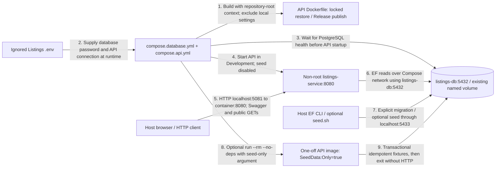
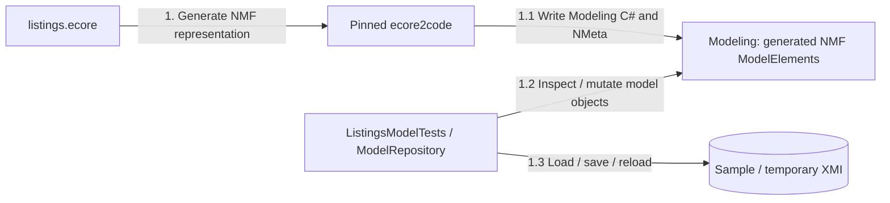
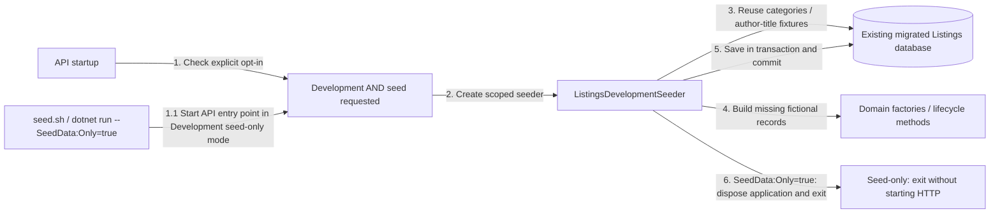
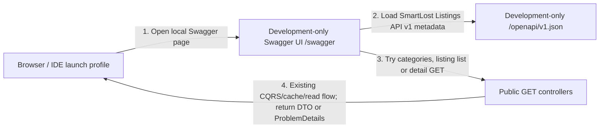
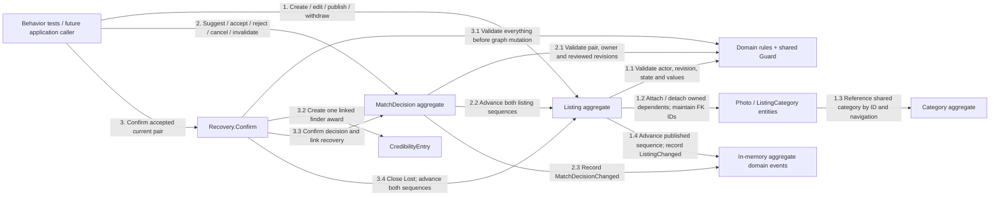
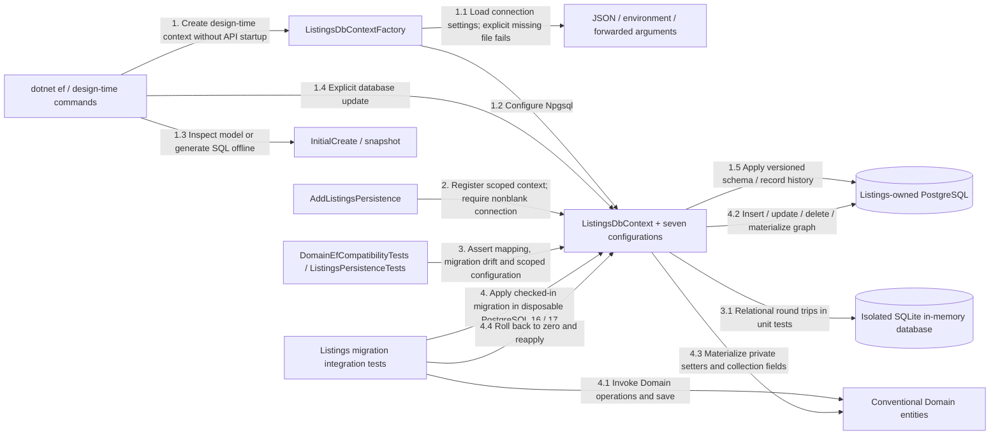
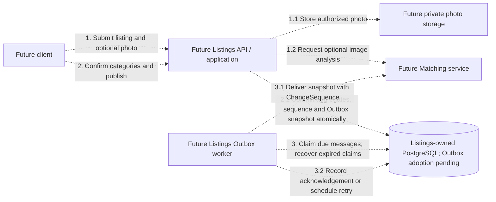

# Listings communication diagrams

Domain implements in-process business behavior. Infrastructure implements EF persistence
and explicit migration tooling. API/Application implement three public read queries
through MediatR. Authenticated mutations, blob and inter-service calls remain unimplemented.
Modeling is a separate NMF representation; runtime projects do not reference it.

## Current local container flow

The database-only file still starts only PostgreSQL. The API override reuses that same
Compose project, network and volume; host port 5081 is bound to loopback. A local dotnet
API and the container cannot bind that port simultaneously. No Auth/Matching network
calls are introduced. API/Compose startup never applies migrations; database health is
not schema readiness. Database read errors follow the existing HTTP 500 path, without a
new query retry policy. Both services use `restart: unless-stopped` for process exits;
one-off seed failures exit nonzero for manual correction/retry. Cache remains per API
process and is cleared on API restart. Stop/down preserve database data unless volume
removal is explicitly requested. Cloud deployment remains inactive.

## Current NMF modeling flow

Solid numbered arrows describe local modeling tools and tests, not a running service.

NMF maintains structural opposites, containment and notifications for model/XMI work.
Domain/Entities and Domain/Enums are maintained manually. There is no Domain generation
or runtime conversion of NMF instances. DomainStructureTests reads Ecore only to check
that the manually maintained Domain fields, enums/defaults and encapsulation remain
consistent with the modeled structure; it does not generate files.

## Current public HTTP read and category-cache flow

```mermaid
flowchart LR
    Client["HTTP client"]
    API["Categories / Listings controller"]
    Validation["MediatR: ExceptionToResult + Validation"]
    Aspect["CachingBehavior: inspect CacheableQueryAttribute"]
    Cache["Singleton IQueryCache / MemoryQueryCache"]
    Handler["Query handler"]
    Port["IListingsReadStore / EF projection"]
    DB[("Listings PostgreSQL")]
    Result["Typed Result / HTTP adapter"]
    Client -->|"1. GET categories, filtered listings or details"| API
    API -->|"2. Bind input; send query and cancellation"| Validation
    Validation -->|"3. Valid query"| Aspect
    Validation -->|"3.1 Invalid query: HTTP 400"| Result
    Aspect -->|"4. Categories: typed/parameter key, TTL 300 seconds"| Cache
    Aspect -->|"4.1 Unmarked list/detail: call next directly"| Handler
    Cache -->|"5. Unexpired hit: immutable successful snapshot"| Result
    Cache -->|"5.1 Miss: await stripe, recheck, invoke next"| Handler
    Handler -->|"6. Read DTOs / filtered page / Open detail"| Port
    Port -->|"7. SELECT AsNoTracking; filter/sort/project/paginate"| DB
    DB -->|"8. Selected values"| Handler
    Handler -->|"9. Categories: freeze DTO list; store only non-cancelled success"| Cache
    Handler -->|"9.1 Return Result; missing/hidden detail maps to 404"| Result
    Result -->|"10. HTTP 200 DTOs or ProblemDetails"| Client
```

Model-binding failures return HTTP 400 before MediatR. Validators run before cache
lookups, including hits. Only GetCategoriesQuery is annotated; unmarked listing/detail
queries always query current Open-only data. Missing, Draft and Closed details remain
indistinguishable (404). Read DTOs exclude private BlobKey and mutable Domain entities.

MemoryQueryCache uses absolute TTL, process-local storage, a 1024-entry capacity and
32 bounded miss-lock stripes. Same-key concurrent misses populate once; hits skip the
handler/read store. Failure Results, thrown exceptions and cancellation are not stored.
Cancelled waiters do not cancel another request's population. GetCategoriesQueryHandler
returns a read-only snapshot of immutable CategoryDto records. Direct catalog changes
can remain stale until expiry; mutation invalidation is not implemented in this phase.

Read requests do not write, start an application transaction or call Auth/Matching/Blob
Storage. Cancellation reaches EF on misses; unexpected exceptions use the shared generic
HTTP 500 handler. Debug cache hit/miss logs identify the query type without parameter
values. See [cache implementation and AOP explanation](../../../docs/QUERY_CACHING.md).

## Current optional development seed flow

The default is no seed. Outside Development, SeedData:Enabled is ignored. Seeding does not
create/migrate a database or upload an image; one fixture carries photo metadata only.
The separate SeedData:Only flag requests seeding even when SeedData:Enabled is false;
it is rejected outside Development before any seed writes. seed.sh uses the existing
API connection settings and finishes without opening an HTTP listener. Startup-enabled
seeding instead continues into the regular read API. Neither mode invalidates the cache
of a separately running API process; its categories can stay stale until TTL/restart.
Repeated sequential runs preserve existing fixture records. Read endpoints expose the
four Open samples; Draft/Withdrawn fixtures remain hidden. Canonical local connection
settings now live beside the API; Infrastructure links that same file for EF CLI.

## Current development API documentation flow

Swagger UI and OpenAPI are not registered outside Development. No JWT authorization or
public seed endpoint is introduced; the existing three public read routes are unchanged.

## Current Domain behavior

Guard failures throw `DomainException`; validation occurs before existing graph changes.
An already confirmed decision rejects another confirmation. Public setters and collection
mutation cannot bypass behavior. The caller supplies actor identity; HTTP authentication
is not implemented here. Cross-root transaction/concurrency, global reservations,
consumed Found eligibility, automatic invalidation and durable retries remain pending.
Events are neither staged in an Outbox nor published to another service.

## Current Infrastructure and explicit migration flows

Solid numbered arrows are implemented calls, exercised by CLI commands and tests.
The API uses this same context for read queries; CLI commands remain independent of HTTP startup.

The test/CLI databases are explicitly chosen: integration containers use isolated databases
and random host ports, while the optional database-only Compose uses localhost:5433.
The root Auth database/Compose stack is unchanged. Offline model/script commands do not
connect to a database. DI registration does not open connections or run migrations;
API and Compose startup do not apply them automatically. Only explicit Development seed
opt-in writes fixture data during API startup; it does not migrate the schema.

Listing Revision/ChangeSequence and decision State protect optimistic writes. Stale saves
throw DbUpdateConcurrencyException; unique/FK violations throw DbUpdateException. No
application retry orchestration is wired. Physical FKs stay inside Listings; Auth user IDs
are logical references. Photo/assignment deletion cascades; historical/shared references
restrict deletion. Local DomainEvents are ignored and are not cleared, staged or delivered.
See [Infrastructure commands/configuration](SmartLost.ListingsService.Infrastructure/README.md)
and the [verification report](../../../docs/LISTINGS_EF_COMPATIBILITY.md).

## Planned service integrations — not implemented

All dashed arrows describe design intent. Exact contracts and retry behavior remain
application/infrastructure work.

Only Listings will access its database/photo storage. Auth identities and Matching
results use logical IDs, without cross-service physical FKs. Auth Outbox reception,
snapshot delivery, inference calls and workers are not implemented in Listings.

## Source references

- [Service state](README.md), [Domain behavior](SmartLost.ListingsService.Domain/README.md)
- [NMF modeling](SmartLost.ListingsService.Modeling/README.md), [manual Domain entities](SmartLost.ListingsService.Domain/Entities/)
- [Model, Domain and persistence tests](../../../tests/Listings/SmartLost.ListingsService.UnitTests/README.md)
- [Proposed publication activity](../../../docs/diagrams/member-4/smartlost-publication-activity.puml)

## Review notes

- 2026-11-08: shared cache expiration lookups no longer remove by key after reading an
  old entry. Concurrent expired category requests recheck under the existing stripe
  and reuse a refresh already completed by another caller. The current cache flow,
  routes, database ownership and failure/cancellation arrows remain unchanged; no new
  service calls or retries were added.

- 2026-11-06: the API runtime Dockerfile now patches/version-checks inherited Ubuntu
  APT packages for USN-8996-1 using HTTPS sources and pins the final ASP.NET runtime to
  patched version 10.0.14. The existing build arrow includes
  this OS maintenance; runtime ports/settings, CQRS/cache/EF arrows, seeding and data
  ownership are unchanged. No new runtime communication or retries were introduced.

- 2026-11-04: added a non-root, digest-pinned API Dockerfile and optional Compose override
  beside the existing database-only stack. New arrows cover image build, runtime settings,
  health ordering, loopback HTTP mapping, internal database DNS and image-based seeding.
  CQRS/cache/data-ownership arrows are unchanged; only the API host placement changes.

- 2026-11-04: enabled attribute-driven cache only on GetCategoriesQuery, with optional
  shared Application behavior and process-local Infrastructure backend. The public flow
  now shows hit/miss branches, expiration, cancellation/failure behavior and unchanged
  uncached list/detail reads. New tests count actual EF SELECTs and control the clock.

- 2026-11-04: renamed the four Application read contracts to CategoryDto, PhotoDto,
  ListingSummaryDto and ListingDetailsDto and moved them to Application/Dtos. Query,
  handler, read-store and controller references use the same renamed types. Numbered
  communication arrows are unchanged because routing, validation, database reads and
  JSON properties are unchanged; OpenAPI schema type names now use the Dto suffix.

- 2026-11-04: moved runtime behavior from Modeling partials into conventional Domain
  entities with local domain events and read-only collections. The Domain generator was
  subsequently removed: declarations and behavior are now maintained together in each
  entity file; enums are maintained in Domain/Enums. NMF output generation stays separate.
  Public read HTTP/CQRS flow and opt-in Development seeding were subsequently added,
  with SQLite TestServer and PostgreSQL HTTP checks. Category query caching was added
  subsequently as documented above; mutation endpoints/inter-service transport remain absent.
  Replaced NMF EF probes with seven-type Domain mapping checks. A subsequent persistence
  setup adopts those mappings in Infrastructure with a design-time factory, InitialCreate,
  scoped DI and optional database-only Compose. Tests now use the real context and apply/
  roll back migrations on PostgreSQL 16/17. Current diagrams include explicit CLI/database
  paths; HTTP, workers, storage and inter-service integrations remain unimplemented.
- Earlier model-only changes added ChangeSequence and the decision/recovery/award
  structure. These remain structural NMF test interactions, separate from Domain operations.
