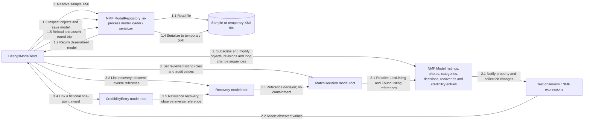
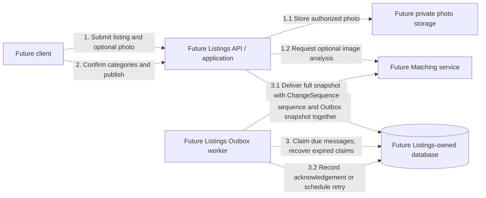

# Listings communication diagrams

The runtime API, Application, Domain and Infrastructure projects are empty scaffolds.
There are no implemented HTTP requests, database operations, photo-storage calls or
messages to other services. The separate NMF Modeling project is implemented and
exercised by model tests; its generated types are not referenced by the runtime layers.

## Current in-process model interactions

Numbered solid arrows show operations exercised by the model tests, not a running
service or a publication endpoint. The three numbered flows are independent.

`ModelRepository` here handles model files; it is not an application database
repository. Tests also exercise containment, opposite references and collection
adapters. No blob or database is created by these interactions.
The confirmed-recovery sample is prepared as model data. Setting a generated property
does not accept a match, close a runtime listing or award points through the application.

## Planned service integrations — not implemented

All dashed arrows below describe design intent, not existing calls or endpoints.
Numbers indicate the proposed publication flow; error handling and exact contracts
remain to be implemented.

Listings will own its data and photo metadata; other services will use explicit
contracts and logical IDs rather than reading its database. Auth outbox reception,
Listings-to-Matching synchronization, delivery transport and inference integration
are unimplemented. The model tests do not establish any of these integrations.

## Source references

- [Current state and project references](README.md)
- [Modeling guide](SmartLost.ListingsService.Modeling/README.md), [generated types](SmartLost.ListingsService.Modeling/Generated/) and [sample XMI](SmartLost.ListingsService.Modeling/Models/campus-backpacks.xmi)
- [Model tests](../../../tests/Listings/SmartLost.ListingsService.UnitTests/ListingsModelTests.cs) and [behavior tests](../../../tests/Listings/SmartLost.ListingsService.UnitTests/ListingsModelTests.Behavior.cs)
- [Recovery model tests](../../../tests/Listings/SmartLost.ListingsService.UnitTests/ListingsModelTests.Recovery.cs) and [confirmed-recovery XMI](SmartLost.ListingsService.Modeling/Models/matched-recovery.xmi)
- [Proposed publication activity](../../../docs/diagrams/member-4/smartlost-publication-activity.puml)

## Review notes

- 2026-10-26: added Listing.ChangeSequence and sequence-bearing model tests/examples.
  Current arrows remain in-process NMF operations. Planned snapshot delivery now names
  the existing Outbox design and its future Listings worker; no receiver, worker,
  transaction, table or network call was added to the Listings runtime.
- 2026-10-26: added three NMF model classes and their model tests. Current in-process
  arrows now include independent decision/recovery/award references. Runtime publication,
  recovery transactions, point allocation, persistence and inter-service communication
  remain unimplemented, so the proposed runtime arrows are unchanged.
- Initial diagrams checked against the empty runtime projects, Modeling project and
  model tests. Update affected flows with service changes; if communication is
  unchanged, record what changed and why these diagrams still apply here.
