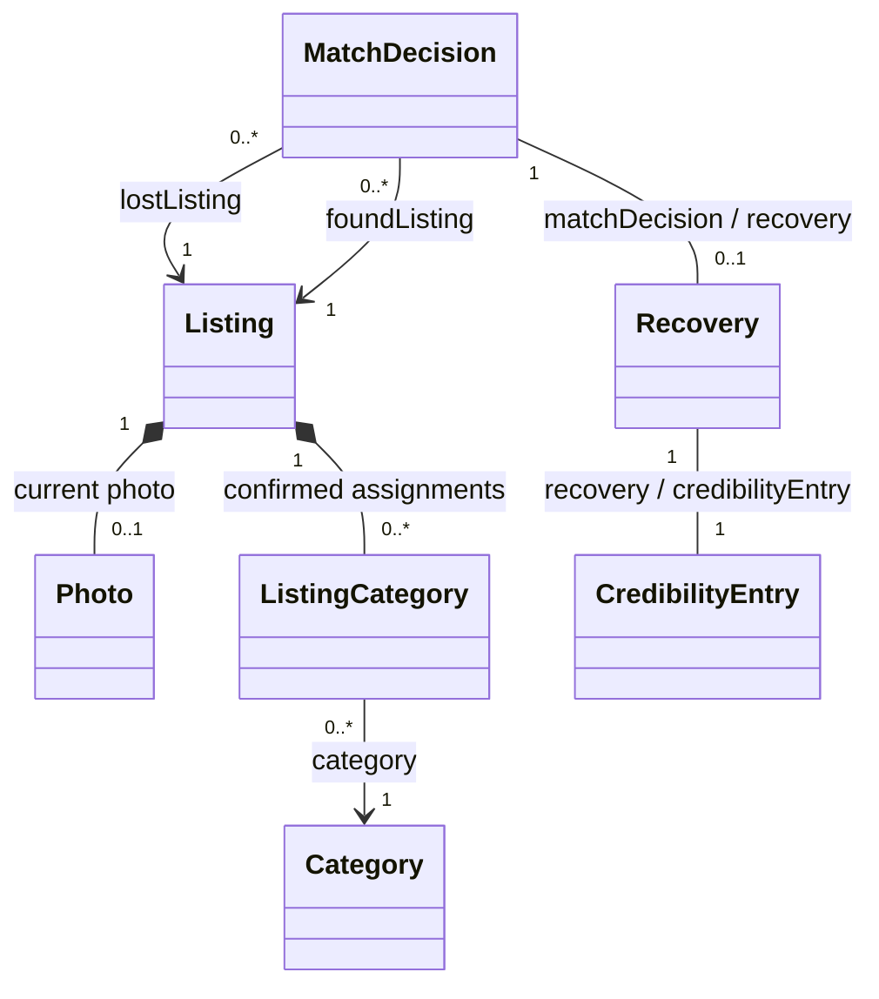

# Listings model with NMF

This .NET 10 library implements the structural model for the optional laboratory
exercise: Listing, Photo, Category, ListingCategory, MatchDecision, Recovery and
CredibilityEntry. It references
`NMF-Basics` **2.0.467** and is included in both [Listings.slnx](../Listings.slnx)
and the root [Aset.slnx](../../../../Aset.slnx).

The repository's existing [.NET tool manifest](../../../../.config/dotnet-tools.json)
also pins `NMF-Ecore2Code` **2.0.467**, whose command name is `ecore2code`.
The tool targets .NET 9 and allows runtime roll-forward; the repository SDK and
projects remain on .NET 10. The library is separate from the runtime layers:
Domain, Application, Infrastructure and Api do not reference Modeling.

## Model files

| File or directory | Role |
| --- | --- |
| [Metamodels/listings.ecore](Metamodels/listings.ecore) | Hand-written source of truth: classes, attributes, enums, references and multiplicities |
| [Metamodels/listings.nmeta](Metamodels/listings.nmeta) | Converted NMeta metamodel, generated from Ecore and embedded in the assembly |
| [Models/campus-backpacks.xmi](Models/campus-backpacks.xmi) | Example instance authored with generated classes and serialized using NMF |
| [Models/matched-recovery.xmi](Models/matched-recovery.xmi) | Fictional confirmed pair, independent recovery and one finder award, serialized using NMF |
| [Generated](Generated/) | Generated C# classes, interfaces, enums and a collection helper; do not edit manually |
| [Transformations](Transformations/) | Reserved for optional custom C# NTL rules; none are implemented |

The flow is Ecore -> NMeta and C# -> model instances serialized as XMI.
The generated namespace is `SmartLost.ListingsService.Modeling.Listings`.
The [project file](SmartLost.ListingsService.Modeling.csproj) embeds the NMeta resource,
registers it through an assembly `ModelMetadata` attribute and copies example XMI files
to build output. The URI `https://smartlost.example/models/listings/v1` identifies
the metamodel; it is not an implemented HTTP endpoint.
There are no custom generation scripts, automatic build-generation steps or NMF-specific CI jobs.
The optional `NMF-Transformations` package is not installed; add it only if custom NTL
rules are selected for the exercise.

## Regeneration

From the repository root, enter the Modeling project and run:

```sh
cd src/Services/Listings/SmartLost.ListingsService.Modeling
dotnet tool restore
dotnet tool run ecore2code -- -f -p -t "System.Guid=System.Guid" --collectionsAreElements -n SmartLost.ListingsService.Modeling -o Generated -m Metamodels/listings.nmeta Metamodels/listings.ecore
dotnet format whitespace Generated --folder --include-generated
```

`-f` writes separate source files. `-p` and the custom type mapping preserve GUID fields
as `System.Guid` rather than falling back to `object`. `--collectionsAreElements`
preserves multiword trait strings as XML elements. `-n` supplies the base namespace;
the Ecore package adds `.Listings`. `-o` selects the C# output directory and `-m`
saves the converted NMeta metamodel. The final command normalizes generated whitespace
using the repository formatting settings without changing the model behavior.

After removing or renaming a type, remove obsolete generated files as well; the
generator does not clean unrelated older output. Keep the embedded resource logical
name and metadata URI synchronized if the metamodel identity or location changes.

From the repository root, build with:

```sh
dotnet restore src/Services/Listings/Listings.slnx --locked-mode
dotnet build src/Services/Listings/Listings.slnx --no-restore --configuration Release --warnaserror
```

## Structural model



Listing contains the current Photo and category assignment objects. The assignments
reference shared Categories, which have an independent lifetime and no inverse assignment
collection. Photo/listing and assignment/listing references have opposites maintained by
generated code. A collection's object uniqueness does not enforce uniqueness of the
business pair `(Listing.Id, Category.Id)`.

Use the containing `Listing.Photo` reference to assign photos. Clear an old photo
before assigning a newly created replacement. Removing contained elements uses NMF's
deletion lifecycle; the tests use new replacement nodes instead of reusing removed ones.
These in-memory operations do not delete a blob from Azure.

Enums are `ListingType { Lost, Found }`, `ListingState { Draft, Open, Closed }` and
`ClosureReason { Recovered, Withdrawn }`. Defaults are Lost, Draft and revision 1.
`ClosureReason` and `PublishedAt` are nullable. Ecore `EDate` maps to `DateTime`;
`OccurredOn` has calendar-date business meaning, with runtime conversion/validation pending.

`Listing.ChangeSequence` is a required `long`, separate from the integer content
Revision. It defaults to 0 for an unsubmitted draft. Runtime publication starts at 1;
subsequent content or eligibility changes increment it atomically, including acceptance,
cancellation, recovery and closure. Pair operations update both affected listings as
needed. The pinned NMF converter cannot deserialize an ELong numeric default, so no
explicit ELong default literal is used. The generated property does not auto-increment.

Listings runtime persistence will commit the changed records, sequence increments and
full-snapshot Outbox messages together with concurrency protection. Outbox envelope
Version is the contract version; ChangeSequence belongs in the snapshot payload. The
existing BuildingBlocks Outbox supplies delivery attempts, leases and retries when a
service integrates it. No duplicate SynchronisationTask class or Outbox model is added
to this metamodel; a future processing view can derive delivery status from Outbox.

The [example XMI](Models/campus-backpacks.xmi) has four model roots: two shared
categories, backpack and bag, and two Open listings with distinct authors, one Lost and
one Found. Four contained assignments reference the same two categories. The Lost
listing has one photo and two multiword traits; the Found listing demonstrates an
optional missing photo. The serializer can omit the default Lost type and revision 1.
Both published examples start with ChangeSequence 1. The blob key is illustrative
metadata; no image is uploaded or included.
No match decision, recovery or point award is represented by this sample.

## Decisions, recoveries and credibility

MatchDecision, Recovery and CredibilityEntry are independent model roots. Their
references are non-containment: a decision does not own either listing, and unlinking
a recovery does not delete the paired listings. Use the explicit `LostListing` and
`FoundListing` properties to assign roles; a generic reference-collection `Add` cannot
distinguish two references with the same target type.

`MatchDecision` records both reviewed revisions and defaults to Suggested, with revision
defaults of 1. `MatchDecisionState` contains Suggested, Accepted, Rejected, Confirmed
and Invalidated. `DecidedBy` and `DecidedAt` are nullable until a human decision exists;
the runtime must require the Lost owner's ID and a UTC timestamp for acceptance or
rejection. Automatic invalidation need not invent a human actor. Cancellation returns
to Suggested; no extra Cancelled state was introduced.

The opposite references represent at most one Recovery per MatchDecision, and one
CredibilityEntry per confirmed Recovery. User identifiers (`DecidedBy`, `ConfirmedBy`,
`BeneficiaryId`, `HelpedUserId`) refer logically to Auth. Entity identifiers are accessed
through references such as `entry.Recovery.Id` rather than duplicate writable FK fields.
`Points` defaults to 1. Totals and distinct helped users are derived views of the ledger.

The [recovery sample](Models/matched-recovery.xmi) has seven roots: two shared categories,
two listings, a confirmed decision, a recovery and an award. The Lost listing is Closed
with reason Recovered; the Found listing remains Open. The finder receives one point
for helping the Lost owner. Fictional IDs and explicit UTC audit values are used. This is
a serialized final-state example, not execution of a business recovery operation.
Both listings have ChangeSequence 3, representing publication, acceptance and confirmed
recovery eligibility updates while their content Revision remains 1.

NMF opposite setters keep the current in-memory links consistent but allow reassignment
and null during construction. They do not enforce historical immutability, authorization,
pair eligibility, reservation uniqueness or persistence. The runtime must enforce unique
recovery/award keys and commit recovery, its eligible award, listing changes and durable
updates consistently. No API, database mapping, migration or point-awarding workflow is
implemented by this model extension. Model tests that delete or relink roots exercise
NMF reference cleanup; they do not authorize deletion of business history.

## Modelled entities and proposed runtime roles

This is a proposal derived from the current
[class diagram](../../../../docs/diagrams/member-2/smartlost-domain-classes.puml)
and [Listings workflows](../../../../docs/diagrams/member-4/README.md).
All seven rows now have NMF representations. These are not runtime domain entities;
runtime aggregate and transaction boundaries remain proposals.

| Candidate | Responsibility and main relationships | Proposed domain role |
| --- | --- | --- |
| `Listing` | Lost/found report: logical `AuthorId`, type, title, description, location, occurrence date, optional colour/traits, lifecycle, closure reason and revision. Owns the current photo and confirmed category assignments. | Aggregate root |
| `Photo` | One current photo per listing at most: private blob key, format, byte size and photo revision. File bytes stay in Blob Storage. | Entity inside Listing |
| `Category` | A normalized reusable category referenced by confirmed listing assignments. Catalog management and synonym rules remain to be decided. | Independent entity; aggregate boundary pending |
| `ListingCategory` | Joins a listing and a confirmed category; duplicate assignments are disallowed. Does not imply that Listing owns the shared category. | Association; a composite key may be sufficient |
| `MatchDecision` | Records a decision about one Lost/Found pair, source revisions, deciding user, state and time. An accepted pair reserves both listings. | Candidate aggregate root; transaction/locking design pending |
| `Recovery` | Immutable confirmation of physical handover for an accepted pair, including confirming user and timestamp. At most one per decision. | Historical entity; commit boundary pending |
| `CredibilityEntry` | Immutable ledger award tied to one recovery, finder beneficiary, helped user and point amount. Totals are derived from the ledger. | Ledger entity; commits consistently with Recovery |

Auth identities are referenced by GUID. A minimal `UserProfileProjection` may be added
later for display names and profile versions received from Auth; it is a local read model,
not a second account aggregate, and must not contain passwords or session tokens.

### Rules to preserve

- `Draft -> Open -> Closed`; no reopening in the semester MVP. Publishing needs at least
  one confirmed category and a non-future occurrence date.
- Only the authenticated author edits or closes their listing. A private draft and its
  photo require owner access.
- At most one current JPEG/PNG photo, up to 10 MiB. Replacing it invalidates stale analysis.
- A decision pairs a Lost listing with a Found listing belonging to a different user.
  At most one accepted decision may reserve each listing. Revisions must be rechecked.
- Acceptance does not close listings or award points. Relevant changes invalidate acceptance.
- The Lost owner confirms the accepted recovery. It closes only the Lost listing and
  consumes Found matching eligibility; the finder's own listing is not automatically closed.
- A matched recovery and its eligible award commit consistently. `RecoveryId` is unique
  in the ledger; no self-awards or points for manual closure. Current semester design awards
  one point per eligible matched recovery.
- Listing content revision and matching-eligibility change sequence are distinct. Updates
  must be delivered durably, and duplicate/older deliveries must be handled safely.

These are requirements for future domain/application validation. This structural model
does not enforce the lifecycle transitions, author-only access, future-date checks,
unique category assignments, photo content/size checks or valid closure combinations.
Required metamodel fields do not replace guards against empty GUIDs, blank values or
invalid partially constructed objects. Generated setters are not the future domain API.

### Technical state and other service boundaries

- `OutboxMessage` is shared delivery infrastructure. The planned implementation of the
  diagram's conceptual `SynchronisationTask` reuses this Outbox in Listings' own database;
  it is not another NMF business aggregate. Runtime adoption remains unimplemented.
- `SearchListing`, `ImageEmbedding`, `EmbeddingPreparationTask` and suggestion ranking belong to Matching.
  A suggestion returned to Listings can be a DTO rather than a persisted Listings entity.
- `ListingType`, `ListingState`, `ClosureReason` and `MatchDecisionState` are enums.
  Location/traits can initially be attributes or value objects, not independent entities.
- Credibility totals and distinct helped-user counts are calculated views of the ledger.
  Real benefits, notifications, chat and moderation remain outside the semester core.

## Next modeling decisions

The Ecore model covers all seven business concepts and the source ChangeSequence.
Next, implement runtime aggregate boundaries, accepted-pair reservation concurrency,
the atomic recovery/award commit and Outbox snapshot delivery. Match processing status
must reflect the consumer checkpoint as well as delivery acknowledgement. Explicit C#
validation is required; structural multiplicities do not enforce those operations.

NMF generates model representation classes. Integration with existing `AggregateRoot`,
domain events, EF Core mappings, transactions and runtime use cases is a separate decision.
Keep generated model types and hand-written domain types in separate namespaces/projects
until an explicit mapping or generation strategy is selected.

## Verification scope and CI

The pinned generator was run, the resulting library was compiled, and the example XMI
was authored using NMF serialization. The
[Listings unit suite](../../../../tests/Listings/SmartLost.ListingsService.UnitTests/README.md)
now loads the XMI, verifies a save/load round trip, checks metamodel structure and
exercises generated property/notification, identity and collection behavior.

The existing overall and changed-code coverage gates remain strictly above 80%.
The tests load Modeling so its executable generated C# appears in Coverlet reports.
Pure interfaces, enums and const-only static classes are declaration-only contracts checked with Roslyn;
generated implementation remains subject to coverage. No implementation exclusion
or percentage relaxation has been introduced. Hosted CI verification is separate
from local test results.

## Local verification on 2026-10-26

The pinned generator and generated-code whitespace formatter completed successfully.
Locked root restore with NuGet audit, Release build with warnings as errors and root
format/analyzer verification passed. All 28 Listings model tests passed; Coverlet
reported 94.35% line coverage for the Modeling assembly. The existing four backend
unit suites passed 180 tests in total after the Matching preparation-task extension.
The CI coverage logic, evaluated locally against the full working change including
new files, passed at 93.40% overall and 95.81% for
changed executable lines. No coverage exclusions or thresholds changed.

Gitleaks scans of Listings source and tests found no secrets. Documentation links and
Ecore/NMeta XML were checked. PostgreSQL integration tests, hosted Windows/Linux CI,
containers and Azure were not run for this structural extension.

## References

- [Official first-project tutorial](https://nmfcode.github.io/models/FirstNmfProject.html)
- [NMeta](https://nmfcode.github.io/models/NMeta.html)
- [NMF transformation language](https://nmfcode.github.io/transformations/index.html)
- [Pinned generator package](https://www.nuget.org/packages/NMF-Ecore2Code/2.0.467)
- [Pinned modeling library](https://www.nuget.org/packages/NMF-Basics/2.0.467)
