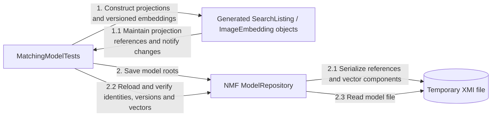
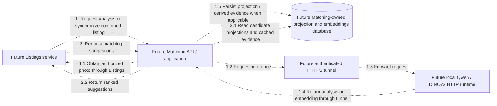

# Matching communication diagram

Matching currently contains four empty runtime-layer projects plus a separate NMF
Modeling library and model unit tests. Its API builds as a library with no Program.cs,
endpoints, handlers, database context, inference client or worker. There is no running
service integration yet.

## Current in-process model interactions

Solid numbered arrows describe model-test operations, not service endpoints.

The model relationship is non-containment and stays within Matching. NMF file loading
is not database persistence or cross-service synchronization. See the
[modeling guide](SmartLost.MatchingService.Modeling/README.md) for fields and remaining rules.

## Planned interactions — not implemented

Every arrow is dashed to mark design intent. Numbers describe the proposed analysis
and suggestion flows independently; they are not existing calls or route names.

Matching will own only derived search data and model evidence. It will obtain photos
through Listings and will not read Auth/Listings databases directly. The standalone
AI experiments are separate console applications; they do not implement this HTTP
runtime or establish a service connection. Routing, synchronization, retries and
authorization contracts remain unimplemented. See the proposed sequence below for
eligibility checking and ranking details; these arrows summarize that design.

## Source references

- [Current state and project references](README.md)
- [API library scaffold](SmartLost.MatchingService.Api/SmartLost.MatchingService.Api.csproj)
- [Proposed matching sequence](../../../docs/diagrams/member-5/smartlost-matching-sequence.puml)
- [Proposed matching components](../../../docs/diagrams/member-5/smartlost-matching-components.puml)
- [Separate AI experiments](../../../AIModels/README.md)

## Review notes

- Added the separate NMF model and unit-test flow for SearchListing/ImageEmbedding.
  Runtime projects remain empty, so all proposed network/database arrows still describe
  unimplemented integrations. No processing job or receiver has been added.
