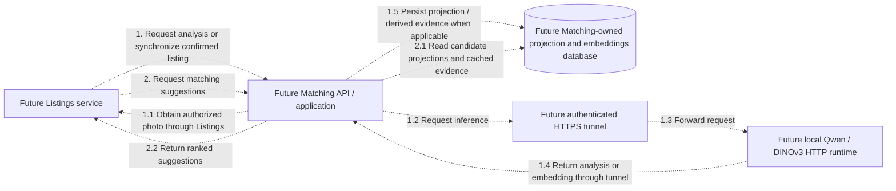

# Matching communication diagram

Matching currently contains four empty runtime-layer projects. Its API builds as a
library, with no `Program.cs`, endpoints, handlers, database context, inference client,
worker or test suite. There is no runtime communication to diagram yet.

## Planned interactions — not implemented

Every arrow is dashed to mark design intent. Numbers describe the proposed analysis
and suggestion flows independently; they are not existing calls or route names.

Matching will own only derived search data and model evidence. It will obtain photos
through Listings and will not read Auth/Listings databases directly. The standalone
AI experiments are separate console applications; they do not implement this HTTP
runtime or establish a service connection. Routing, synchronization, retries and
authorization contracts remain unimplemented. See the proposed sequence below for
eligibility checking and ranking details; these arrows summarize that design.

## Source references

- [Current state and project references](README.md)
- [API library scaffold](SmartLost.MatchingService.Api/SmartLost.MatchingService.Api.csproj)
- [Proposed matching sequence](../../../docs/diagrams/member-5/smartlost-matching-sequence.puml)
- [Proposed matching components](../../../docs/diagrams/member-5/smartlost-matching-components.puml)
- [Separate AI experiments](../../../AIModels/README.md)

## Review notes

- Initial diagram checked against all four empty projects and the proposed matching
  design. Update arrows and implementation labels as code is introduced; if
  communication is unchanged, record what changed and why this diagram still applies here.
