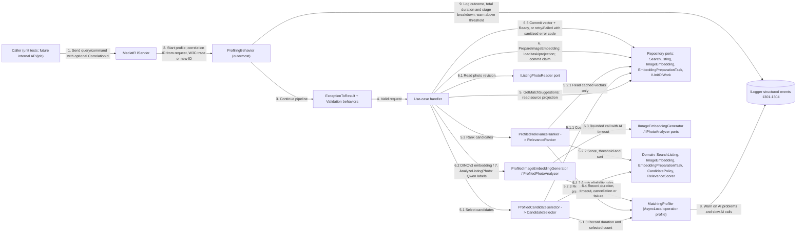
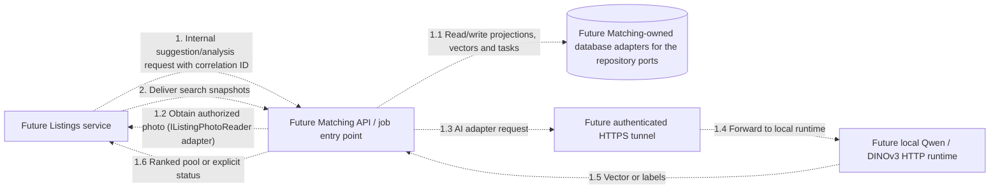

# Matching communication diagram

Matching now contains runtime Domain and Application code, plus the separate NMF Modeling
library and unit tests. The Application layer implements three MediatR use cases:
suggestion ranking, embedding preparation and photo analysis. It also adds a profiling
pipeline behavior and profiling decorators. Persistence, Listings photo access and the
local AI runtime are **ports only**. No adapter, API entry point, endpoint, database
context, worker or container exists yet. Unit tests replace these ports with in-memory fakes.

## Current in-process runtime interactions

Solid arrows are implemented in-process calls that unit tests exercise. Nodes marked
"port" are interfaces without a production implementation.

The handlers contain no measurement code. Stage timings come from the decorators
registered in `AddApplication`. AI timings come from `AddMatchingAiProfiling`, which
must be called after a future Infrastructure layer registers the AI adapters.
Profiling logs contain error codes and exception type names. They never contain
exception messages, photo bytes or model output.

Failure and retry paths that are implemented:

- **Suggestions.** A missing or older projection returns `Pending`. An ineligible source
  returns `Unavailable`. A newer projection returns the `matching.source_revision_newer`
  conflict. An empty candidate pool returns `Ready` with no suggestions.
- **Embedding preparation.** An outdated photo/model target becomes `Obsolete` without
  inference. Several failures return the task to `Pending` with `NextAttemptAtUtc`, or
  make it `Failed` once `MaximumAttempts` is reached:
  - an unavailable photo
  - an AI timeout
  - an `AiInferenceException`
  - a version mismatch
  - an invalid vector

  If the caller cancels, the lease is left to expire so a later claim can retry the task.
- **Photo analysis.** Missing photos and AI failures map to explicit result errors.

## Current model-test interactions

The NMF model tests are unchanged. They construct generated model objects and
round-trip them through temporary XMI files. Runtime code does not reference Modeling.

## Planned interactions — not implemented

Every arrow is dashed to mark design intent. These are not existing calls or route names.

Matching will own only derived search data and model evidence. It will obtain photos
through Listings and will not read Auth/Listings databases directly. Snapshot
application (`ChangeSequence` checkpoints), pair rejections and category synonym
normalization are not implemented.

## Source references

- [Current state and project references](README.md)
- [Profiling behavior](SmartLost.MatchingService.Application/Profiling/ProfilingBehavior.cs)
  and [profiler](SmartLost.MatchingService.Application/Profiling/MatchingProfiler.cs)
- [Registration](SmartLost.MatchingService.Application/DependencyInjection.cs)
- [Proposed matching sequence](../../../docs/diagrams/member-5/smartlost-matching-sequence.puml)
- [Proposed matching components](../../../docs/diagrams/member-5/smartlost-matching-components.puml)
- [Separate AI experiments](../../../AIModels/README.md)

## Review notes

- 2026-11-05: added the runtime Domain entities (reproduced from `matching.ecore`) and
  Application use cases. Also added `ProfilingBehavior`, stage/AI profiling decorators and
  the unit tests for them. The current diagram now shows these in-process calls. Planned
  arrows were reduced to the adapters and entry points that still do not exist. No
  Listings, Auth, BuildingBlocks or Compose code changed. Domain files are grouped as
  `Entities/`, `ValueObjects/`, `Enums/`, `Suggestions/` and `Errors/`, following Auth's
  `Domain/Entities/` convention. This is a namespace change only; communication is unchanged.
  Application use cases follow Auth's `Commands/<UseCase>/` layout, with `Queries/<UseCase>/`,
  `Contracts/`, `Interfaces/`, `Services/` and `Exceptions/`; also a namespace change only.
- 2026-10-26: added the independent EmbeddingPreparationTask model, five state values
  and model tests.
- 2026-10-26: added nullable CurrentPhotoId/CurrentPhotoRevision to SearchListing.
- Added the separate NMF model and unit-test flow for SearchListing/ImageEmbedding.
