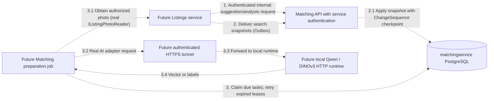

# Matching communication diagram

Matching runs as an ASP.NET Core API with its own PostgreSQL database. The Application layer
implements three MediatR use cases: suggestion ranking, embedding preparation and photo
analysis. Every request passes through the profiling pipeline behavior and profiling
decorators. The Listings photo reader and the DINOv3/Qwen adapters are **mocks**; no real
Listings or AI runtime connection exists. All HTTP routes are development-only test endpoints
without service authentication.

## Current implemented interactions

Solid arrows are implemented and exercised by unit tests and by the Compose container.

```mermaid
flowchart LR
    Client["Developer / .http file / unit tests"]
    Api["MatchingController / MatchingDemoController (Development only)"]
    Seeder["MatchingDemoSeeder"]
    Mediator["MediatR ISender"]
    Profiling["BuildingBlocks ProfilingBehavior (outermost)"]
    Pipeline["ExceptionToResult + Authorization + Validation + Caching behaviors"]
    Handler["Use-case handler"]
    Selector["ProfiledCandidateSelector -> CandidateSelector"]
    Ranker["ProfiledRelevanceRanker -> RelevanceRanker"]
    AiDecorators["ProfiledImageEmbeddingGenerator / ProfiledPhotoAnalyzer"]
    MockAi["Mock DINOv3 / Qwen adapters"]
    MockPhotos["MockListingPhotoReader (static demo photos)"]
    Profiler["MatchingProfiler / shared IProfilingContext"]
    Logs[("ILogger events 1301-1304 (container stdout)")]
    DB[("matchingservice PostgreSQL: SearchListings, ImageEmbeddings, EmbeddingPreparationTasks")]

    Client -->|"1. HTTP POST with optional X-Correlation-ID"| Api
    Api -->|"1.1 demo/seed: delete all rows, insert fixed scenario"| Seeder
    Seeder -->|"1.2 Write projections and Pending tasks"| DB
    Api -->|"2. Send query/command"| Mediator
    Mediator -->|"3. Start profile and resolve correlation ID"| Profiling
    Profiling -->|"4. Continue pipeline"| Pipeline
    Pipeline -->|"5. Valid request"| Handler
    Handler -->|"6. Suggestions: read source projection"| DB
    Handler -->|"6.1 Select candidates"| Selector
    Selector -->|"6.1.1 Coarse pool query; domain rules applied in memory"| DB
    Handler -->|"6.2 Rank candidates"| Ranker
    Ranker -->|"6.2.1 Read cached vectors only"| DB
    Selector -->|"6.3 Record duration and counts"| Profiler
    Ranker -->|"6.3 Record duration and counts"| Profiler
    Handler -->|"7. Embedding: load task/projection; commit claim"| UOW["MatchingUnitOfWork"]
    UOW -->|"7.0 SaveChanges with xmin concurrency"| DB
    UOW -->|"7.0.1 Competing update: DomainException -> HTTP 409"| Pipeline
    Handler -->|"7.1 Read photo revision"| MockPhotos
    Handler -->|"7.2 Embedding call on pending task"| AiDecorators
    Handler -->|"8.1 Analysis: recheck requested photo access every time"| MockPhotos
    Handler -->|"8.2 After photo read succeeds, dispatch AnalyzePhotoContentQuery"| AnalysisCache["MediatR CachingBehavior / process-local IQueryCache"]
    AnalysisCache -->|"8.3 Cache miss: analyze permitted photo bytes"| AiDecorators
    AnalysisCache -->|"8.4 Success: reuse immutable labels for 300 seconds"| Handler
    AiDecorators -->|"7.3 Bounded call with AI timeout"| MockAi
    AiDecorators -->|"7.4 Record duration, timeout, cancellation or failure"| Profiler
    Handler -->|"7.5 Commit vector + Ready, or retry/exhausted Failed with sanitized code"| DB
    Profiler -->|"9. Warn on AI problems and slow AI calls"| Logs
    Profiling -->|"10. Log outcome, total duration and stages; warn above threshold"| Logs
    Logs -->|"10.1 Copy last 100 Matching/shared profiling entries (Development)"| LogBuffer["RecentLogBuffer"]
    Client -->|"12. GET demo/logs?count=10"| Api
    Api -->|"12.1 Read newest entries"| LogBuffer
    Api -->|"11. JSON result or problem details (AI failures: 503)"| Client
```

Failure and retry paths that are implemented:

- **Suggestions.** A missing or older projection returns `Pending`. An ineligible source
  returns `Unavailable`. A newer projection returns the 409 `matching.source_revision_newer`
  conflict. An empty candidate pool returns `Ready` with no suggestions.
- **Embedding preparation.** An outdated photo/model target becomes `Obsolete` without
  inference. A task that is not due returns 409. The following failures return the task to
  `Pending` with `NextAttemptAtUtc`, or make it `Failed` at `MaximumAttempts`:
  - an unavailable photo
  - an AI timeout
  - an `AiInferenceException`
  - a version mismatch
  - an invalid vector

  If the caller cancels, the lease is left to expire. A later claim retries only while the
  attempt budget remains; an expired final lease becomes Failed without another inference.
  Competing xmin updates become the 409 matching.concurrent_update conflict. AI deadlines
  request cancellation, discard late results and report TimedOut; uncooperative asynchronous
  adapters are no longer awaited, and real adapters must stop their own work on cancellation.
  No worker re-runs due tasks automatically; they are processed through the test endpoints.
- **Photo analysis.** The uncached outer query rechecks photo access before every cache
  lookup. Missing/no-longer-permitted photos return 404; AI failures return 503 and are
  not cached. Only input-only inference is cached: photo identifiers/revision, bytes and
  media type form the key, excluding correlation ID. Hits skip inference, while misses
  retain the bounded AI call and error mapping. Successful nested label lists are frozen;
  absolute expiry is 300 seconds. Current adapters are mocks, with no outgoing network call.

## Current model-test interactions

The NMF model tests are unchanged. They construct generated model objects and
round-trip them through temporary XMI files. Runtime code does not reference Modeling.

## Planned interactions — not implemented

Every arrow is dashed to mark design intent. These are not existing calls or route names.

Matching will own only derived search data and model evidence. It will obtain photos
through Listings and will not read Auth/Listings databases directly. Pair rejections and
category synonym normalization are not implemented.

## Source references

- [Current state, endpoints and tables](README.md)
- [Test requests](SmartLost.MatchingService.Api/MatchingService.Api.http)
- [Profiling behavior](../../BuildingBlocks/SmartLost.BuildingBlocks.Application/Behaviors/ProfilingBehavior.cs)
  and [profiler](SmartLost.MatchingService.Application/Profiling/MatchingProfiler.cs)
- [Persistence](SmartLost.MatchingService.Infrastructure/Persistence/MatchingDbContext.cs)
  and [migration](SmartLost.MatchingService.Infrastructure/Persistence/Migrations/)
- [Proposed matching sequence](../../../docs/diagrams/member-5/smartlost-matching-sequence.puml)
- [Proposed matching components](../../../docs/diagrams/member-5/smartlost-matching-components.puml)

## Review notes

- 2026-11-10: MatchingUnitOfWork now inherits shared EfUnitOfWork<MatchingDbContext>; only
  concurrency error mapping remains service-specific. Explicit rollback now discards tracked
  state through the shared adapter. Separate claim/result saves and the AI call outside a
  transaction are unchanged. No Outbox or authorization/runtime service calls are
  added; numbered flows retain their existing behavior.

- 2026-11-09: Root Compose now groups all three APIs and their databases. Listings containers
  were moved from the standalone project while reusing the existing volume as external; fresh
  setups use a managed volume. Only container grouping, network placement and configuration
  paths change. HTTP routes, database ownership, CQRS/worker flows and outgoing service calls
  are unchanged.

- 2026-11-08: added the input-only photo-analysis cache flow (8.1-8.4). The outer query
  still checks photo access on every request, including hits. Suggestions and identity
  remain uncached; no route, persistence ownership, worker, migration or service call
  changes. Tests verify permission rechecks, key isolation, expiry, failures and snapshots.

- 2026-11-08: Enabled shared authorization and caching wrappers alongside profiling. Current
  Development-only requests have neither attribute and still query current eligibility; no
  suggestion results are cached. Database, mock-adapter and profiling arrows are unchanged.
  Matching Domain already references the shared Listings contract; no synchronization endpoint,
  worker or migration is added.

- 2026-11-08: integrated Listings/API/cache with main's Matching runtime and authorization.
  SearchListing and consumers now use the shared Contracts.Listings ListingType, with the
  same Lost/Found values and EF mapping; no migration is required. Matching still enables
  only profiling. Its host PostgreSQL port is 5434 to coexist with Listings on 5433;
  container connections remain matching-db:5432. Current numbered use-case/mock/DB arrows
  and planned real service/AI arrows remain accurate; no new network integration is added.

- 2026-11-08: reviewed the shared attribute-based AuthorizationBehavior added for Auth.
  Matching does not enable that opt-in behavior, so its profiling, persistence, mock-adapter
  and external-interaction arrows remain unchanged.
- 2026-11-08: extracted the outer profiling behavior and generic context/contracts into
  BuildingBlocks, while Matching retains stage/AI decorators. The diagram now labels
  the shared behavior and Infrastructure concurrency mapping. Added deadline/late-result
  handling, attempt-limit recovery and disposable PostgreSQL HTTP regression tests.
  No new service calls, endpoints or schema migration are introduced.

- 2026-11-05: the Dockerfile runtime stage runs `apt-get upgrade` so the image includes Ubuntu
  security fixes newer than `aspnet:10.0` and passes the CI Trivy image gate. Communication is unchanged.
- 2026-11-05: added `GET /api/matching/demo/logs`, backed by a Development-only logging
  provider that copies the last 100 Matching log entries into `RecentLogBuffer`. Added arrows 10.1, 12 and 12.1.
- 2026-11-05: added the API entry point, development test endpoints, Dockerfile and Compose
  services (`matching-db`, `matching-service`), the `matchingservice` database with the
  `InitialCreate` migration, EF repositories, mock photo/AI adapters and the demo seeder.
  The current diagram now includes HTTP, PostgreSQL and mock adapter arrows. The planned
  diagram keeps only the real Listings, worker and AI runtime integrations.
- 2026-11-05: added the runtime Domain entities (reproduced from `matching.ecore`),
  Application use cases, `ProfilingBehavior`, stage/AI profiling decorators and unit tests.
  Domain files are grouped as `Entities/`, `ValueObjects/`, `Enums/`, `Suggestions/` and
  `Errors/`. Application use cases follow Auth's `Commands/<UseCase>/` layout, with
  `Queries/<UseCase>/`, `Contracts/`, `Interfaces/`, `Services/` and `Exceptions/`.
- 2026-10-26: added the independent EmbeddingPreparationTask model, five state values
  and model tests.
- 2026-10-26: added nullable CurrentPhotoId/CurrentPhotoRevision to SearchListing.
- Added the separate NMF model and unit-test flow for SearchListing/ImageEmbedding.
