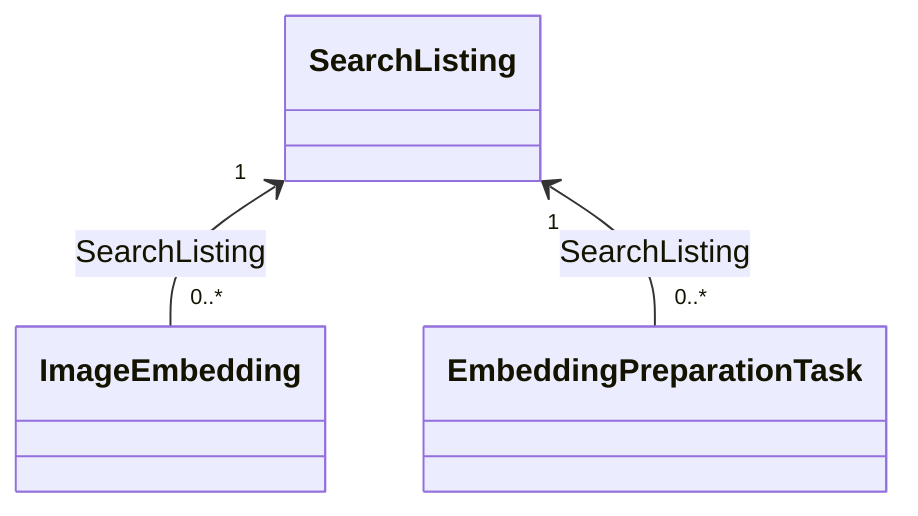

# Matching model with NMF

This .NET 10 library contains NMF representations of `SearchListing`,
`ImageEmbedding` and `EmbeddingPreparationTask`, generated with the repository's pinned `NMF-Ecore2Code` 2.0.467.
It references `NMF-Basics` 2.0.467 and belongs to both Matching.slnx and Aset.slnx.
The four runtime layers do not reference Modeling. These classes are structural
models, not integrated DDD aggregates or EF entities.

## Source and generation

- [matching.ecore](Metamodels/matching.ecore) is the source of truth.
- [matching.nmeta](Metamodels/matching.nmeta) is generated metadata embedded in the assembly.
- [Generated](Generated/) contains generated classes, interfaces and enums. Do not edit these manually.
- The model URI `https://smartlost.example/models/matching/v1` identifies metadata; it is not an HTTP endpoint.

From the repository root:

```sh
cd src/Services/Matching/SmartLost.MatchingService.Modeling
dotnet tool restore
dotnet tool run ecore2code -- -f -p -t "System.Guid=System.Guid" --collectionsAreElements -n SmartLost.MatchingService.Modeling -o Generated -m Metamodels/matching.nmeta Metamodels/matching.ecore
dotnet format whitespace Generated --folder --include-generated
```

The command uses the existing tool manifest; generation is manual, not an automatic
build step. Remove obsolete generated files when renaming/removing model types.

## Entities and relationship

| Type | Identity and data |
| --- | --- |
| SearchListing | ListingId; SourceRevision, ChangeSequence, Type, AuthorId, optional CurrentPhotoId/CurrentPhotoRevision, CategoryKeys, Colour, Traits, OccurredOn, Location and Eligible |
| ImageEmbedding | Id; SearchListing reference, PhotoId, PhotoRevision, ModelVersion, PreprocessingVersion, Dimensions and Vector |
| EmbeddingPreparationTask | Id; SearchListing reference, captured PhotoId/PhotoRevision and model/preprocessing versions, State, AttemptCount, NextAttemptAt, LeaseId, LeaseExpiresAt and LastError |



The relationship is non-containment: embeddings and projections have independent
model lifetimes and can be separate XMI roots. The unidirectional
ImageEmbedding.SearchListing reference identifies its projection; embedding records
are independent model roots rather than an embedded collection.
`ImageEmbedding.SearchListing.ListingId`
provides the source listing ID; a duplicate writable ListingId is deliberately absent
from ImageEmbedding. This is an in-model Matching relationship, not a database foreign
key to the Listings service. ListingType is a local enum with Lost/Found values;
there is no dependency on the Listings model assembly.

Vectors use an ordered, non-unique float collection: repeated components and component
order must survive serialization. CategoryKeys and Traits are unordered sets. The
revision defaults are 1; Eligible defaults to false. OccurredOn uses EDate/DateTime
with calendar-date semantics; ChangeSequence is a long, separate from content revision.

`CurrentPhotoId` is `Guid?` and `CurrentPhotoRevision` is `int?`. Both default to null
and must be absent when the source listing has no photo. When a photo exists, the
source snapshot supplies both its identifier and positive revision. Replacing a photo
changes its ID; updating that photo's content changes its revision. A new photo may
start at revision 1. These are logical source identifiers, not a navigation/FK into
the Listings database.

The pair identifies the current photo among historical ImageEmbedding records. Cache
selection must match both fields as well as model/preprocessing versions. Removing or
replacing a photo does not automatically delete cached model roots. Empty photo fields
mean there is no current visual evidence, even if historical embeddings remain.

## Embedding preparation work

`EmbeddingPreparationTask` is an independent model root. Its required SearchListing
reference is non-containment and exposes the listing ID without another writable ID
field. PhotoId, PhotoRevision, ModelVersion and PreprocessingVersion capture the exact
processing target; changing the projection does not rewrite those task properties.

`EmbeddingPreparationState` contains Pending, Processing, Ready, Failed and Obsolete.
Defaults are Pending, AttemptCount 0 and PhotoRevision 1. NextAttemptAt, LeaseId,
LeaseExpiresAt and LastError are nullable. EDate fields map to DateTime; runtime
validation must enforce UTC. Lease fields describe a future temporary worker claim,
not an implemented lock. LastError is intended for a sanitized error code.

The proposed runtime transitions are Pending -> Processing -> Ready; a retryable
failure returns to Pending with NextAttemptAt, exhausted attempts become Failed, and
an outdated photo/model target becomes Obsolete. A future explicit retry may reset
failed work according to policy. Generated setters do not enforce these transitions.

Future persistence must make `(ListingId, PhotoId, PhotoRevision, ModelVersion,
PreprocessingVersion)` unique. Projection/checkpoint updates and required task creation
must commit together before acknowledging a Listings snapshot. Workers claim due work
atomically, recover expired leases and bound inference time/concurrency. Result commits
must recheck the current photo/version target and lease ownership; embedding upsert and
Ready status must commit together. Metadata-only changes can reuse the same target.
The model adds no queue processor, HTTP call, migration, retry scheduler or database index.

Listings will reuse its own BuildingBlocks Outbox table to deliver complete search
snapshots. SearchListing.ChangeSequence is the proposed per-listing checkpoint: newer
snapshots replace derived state; duplicate/older snapshots are acknowledged without
reapplying them. Keep an ineligible projection/checkpoint after closure to prevent old
deliveries from resurrecting it. Source content revision and change sequence are separate.

## Runtime rules not yet implemented

The model does not validate nonempty IDs, blank strings, positive revisions, increasing
change sequences, category normalization, source ownership or listing eligibility.
A required reference can still be null while constructing a model. NMF multiplicities
are not substitutes for business validation.

Embedding cache uniqueness by photo/revision/model/preprocessing version, finite normalized
components, vector length matching Dimensions and compatible-vector comparison must be
implemented in the runtime domain/application/persistence layers. No dimension is hardcoded
in the model. Required vector multiplicity does not automatically reject empty vectors.
NMF does not enforce both-or-neither photo fields, nonempty photo IDs or a positive
photo revision. The runtime must validate the pair and reject stale photo evidence;
the generated setters implement no cache selector or automatic invalidation.
Nonempty task IDs/versions, positive photo revisions, nonnegative attempt counts, valid
lease pairs, target uniqueness, transitions and terminal-state policies require runtime
validation and database constraints. Task target immutability and atomic checkpoint/work
persistence are not enforced by NMF. Reservation/rejection integration remains runtime work.

MatchSuggestion remains a calculated result, not an added persistent entity. No user,
original Listing/Photo, recovery, credibility, inference client, endpoint, database or
migration is introduced. Integration with AggregateRoot/domain events and EF mapping
remains separate from NMF generation.

## Tests

[Matching model tests](../../../../tests/Matching/SmartLost.MatchingService.UnitTests/README.md)
exercise metadata, XMI round trips, float vector order/duplicates, versioned cache records,
projection references, notifications and identity resolution. Current-photo tests cover
nullable defaults, reflective clearing, and removal/replacement/revision XMI round trips
while retaining historical embeddings. Task tests cover all five serialized states,
captured targets, nullable retry/lease fields, notifications, references and identity.
These checks do not implement runtime ranking, retry execution or snapshot ordering.
Run from the repository root:

```sh
dotnet restore src/Services/Matching/Matching.slnx --locked-mode
dotnet build src/Services/Matching/Matching.slnx --no-restore --configuration Release --warnaserror
dotnet test tests/Matching/SmartLost.MatchingService.UnitTests/SmartLost.MatchingService.UnitTests.csproj --no-build --no-restore --configuration Release --collect:"XPlat Code Coverage" --settings coverage.runsettings
```

Tests use temporary XMI files and no database or Docker. Generated executable code remains
subject to the existing Coverlet gates; no coverage exclusion is added.

## Local verification on 2026-10-26

Regeneration with the pinned NMF tool, root Release build with warnings as errors and
root formatting/analyzer verification passed. All 25 Matching model tests passed with
93.18% line coverage for SmartLost.MatchingService.Modeling. All four backend unit
suites passed 180 tests. The existing CI coverage logic evaluated locally against the
combined working changes passed at 93.40% overall and 95.81% for changed executable
lines, including the source sequence and preparation-task extensions. No coverage exclusions or thresholds
changed. Metamodel XML and documentation links were checked. Hosted GitHub CI,
database/container integration and live inference were not run for this model-only change.
