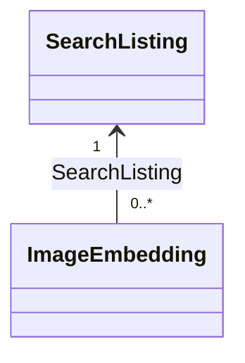

# Matching model with NMF

This .NET 10 library contains NMF representations of `SearchListing` and
`ImageEmbedding`, generated with the repository's pinned `NMF-Ecore2Code` 2.0.467.
It references `NMF-Basics` 2.0.467 and belongs to both Matching.slnx and Aset.slnx.
The four runtime layers do not reference Modeling. These classes are structural
models, not integrated DDD aggregates or EF entities.

## Source and generation

- [matching.ecore](Metamodels/matching.ecore) is the source of truth.
- [matching.nmeta](Metamodels/matching.nmeta) is generated metadata embedded in the assembly.
- [Generated](Generated/) contains generated classes, interfaces and ListingType. Do not edit these manually.
- The model URI `https://smartlost.example/models/matching/v1` identifies metadata; it is not an HTTP endpoint.

From the repository root:

```sh
cd src/Services/Matching/SmartLost.MatchingService.Modeling
dotnet tool restore
dotnet tool run ecore2code -- -f -p -t "System.Guid=System.Guid" --collectionsAreElements -n SmartLost.MatchingService.Modeling -o Generated -m Metamodels/matching.nmeta Metamodels/matching.ecore
dotnet format whitespace Generated --folder --include-generated
```

The command uses the existing tool manifest; generation is manual, not an automatic
build step. Remove obsolete generated files when renaming/removing model types.

## Entities and relationship

| Type | Identity and data |
| --- | --- |
| SearchListing | ListingId; SourceRevision, ChangeSequence, Type, AuthorId, CategoryKeys, Colour, Traits, OccurredOn, Location and Eligible |
| ImageEmbedding | Id; SearchListing reference, PhotoId, PhotoRevision, ModelVersion, PreprocessingVersion, Dimensions and Vector |



The relationship is non-containment: embeddings and projections have independent
model lifetimes and can be separate XMI roots. The unidirectional
ImageEmbedding.SearchListing reference identifies its projection; embedding records
are independent model roots rather than an embedded collection.
`ImageEmbedding.SearchListing.ListingId`
provides the source listing ID; a duplicate writable ListingId is deliberately absent
from ImageEmbedding. This is an in-model Matching relationship, not a database foreign
key to the Listings service. ListingType is a local enum with Lost/Found values;
there is no dependency on the Listings model assembly.

Vectors use an ordered, non-unique float collection: repeated components and component
order must survive serialization. CategoryKeys and Traits are unordered sets. The
revision defaults are 1; Eligible defaults to false. OccurredOn uses EDate/DateTime
with calendar-date semantics; ChangeSequence is a long, separate from content revision.

## Runtime rules not yet implemented

The model does not validate nonempty IDs, blank strings, positive revisions, increasing
change sequences, category normalization, source ownership or listing eligibility.
A required reference can still be null while constructing a model. NMF multiplicities
are not substitutes for business validation.

Embedding cache uniqueness by photo/revision/model/preprocessing version, finite normalized
components, vector length matching Dimensions and compatible-vector comparison must be
implemented in the runtime domain/application/persistence layers. No dimension is hardcoded
in the model. Required vector multiplicity does not automatically reject empty vectors.
The model does not track current source photo selection, pair rejections/reservations,
processing jobs or atomic checkpoints; those contracts and schemas remain to be designed.

MatchSuggestion remains a calculated result, not an added persistent entity. No user,
original Listing/Photo, recovery, credibility, inference client, endpoint, database or
migration is introduced. Integration with AggregateRoot/domain events and EF mapping
remains separate from NMF generation.

## Tests

[Matching model tests](../../../../tests/Matching/SmartLost.MatchingService.UnitTests/README.md)
exercise metadata, XMI round trips, float vector order/duplicates, versioned cache records,
projection references, notifications and identity resolution. Run from the repository root:

```sh
dotnet restore src/Services/Matching/Matching.slnx --locked-mode
dotnet build src/Services/Matching/Matching.slnx --no-restore --configuration Release --warnaserror
dotnet test tests/Matching/SmartLost.MatchingService.UnitTests/SmartLost.MatchingService.UnitTests.csproj --no-build --no-restore --configuration Release --collect:"XPlat Code Coverage" --settings coverage.runsettings
```

Tests use temporary XMI files and no database or Docker. Generated executable code remains
subject to the existing Coverlet gates; no coverage exclusion is added.

## Local verification

Generated with the pinned NMF tool; locked restore and Release builds of Matching.slnx
and Aset.slnx passed with warnings treated as errors. Root solution formatting/analyzer
verification passed. All seven Matching model tests passed with 89.79% line coverage
for SmartLost.MatchingService.Modeling. This is the new model assembly's coverage,
not a claim about the complete application's merged coverage. GitHub CI, database,
container and live inference verification were not run for this model-only change.
